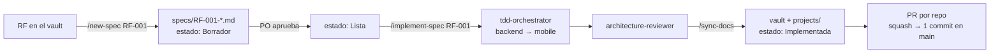
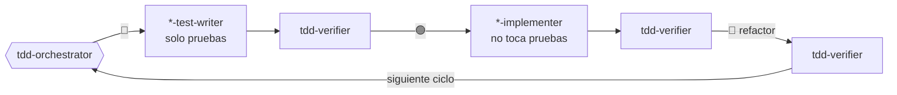

# waggo-workspace

Punto de entrada para desarrollar **Waggo — Plataforma Inteligente para Paseo Seguro de Perros**.

Waggo conecta a dueños de perros con paseadores **verificados**: el dueño solicita un paseo, lo sigue en vivo por GPS y paga solo cuando el servicio termina bien. El producto son dos repos; este repo no tiene código de producto, tiene lo que los une y le dice a Claude Code cómo trabajar en ellos: specs, agentes, skills, reglas y checklists.

| Repo | Qué es |
|---|---|
| [waggo-api](https://github.com/Faebb/waggo-api) | Backend: API REST en .NET 10, Clean Architecture, PostgreSQL + PostGIS |
| [waggo-mobile](https://github.com/Faebb/waggo-mobile) | App para iOS, Android y Web con Expo + React Native |
| **waggo-workspace** (este) | Specs, agentes y skills de Claude Code, checklists, scripts |
| Vault Waggo (Obsidian) | Documentación en español: visión, requerimientos, arquitectura, ADR, roadmap |

## Qué contiene
| Carpeta | Qué contiene |
|---|---|
| `specs/` | Especificaciones por requerimiento (RF): contrato, tabla de ejemplos y plan TDD. Se escriben **antes** del código. |
| `.claude/agents/` | Subagentes de Claude Code con un rol cada uno (analista, TDD, revisor, documentación). |
| `.claude/skills/` | Flujos reutilizables que se invocan como `/comando` (`/new-spec`, `/implement-spec`, `/sync-docs`...). |
| `.claude/rules/` | Checklists del backend y de mobile: dónde va cada archivo y qué debe cumplir un cambio. Los agentes las leen antes de trabajar. |
| `.claude/hooks/` | Guardia TDD que separa los roles de los agentes. |
| `.claude/settings.json` | Permisos compartidos y acceso a los repos hermanos. |
| `projects/` | README de cada repo, copiados con `scripts/sync-readmes.ps1`. |
| `scripts/` | Lanzador de Claude, sincronización de READMEs y configuración de GitHub. |

## Requisitos
- Git, [Claude Code](https://docs.claude.com/en/docs/claude-code/overview) y PowerShell 7 (para los scripts).
- Backend: .NET SDK 10 y Docker Desktop.
- Mobile: Node.js 22 LTS y Expo Go (o un emulador).
- Opcional: Obsidian para leer el vault.

## Puesta en marcha
### 1. Clonar los tres repos juntos
Los repos se buscan entre sí por rutas relativas, así que deben quedar como hermanos:

```powershell
mkdir source\repos\Waggo; cd source\repos\Waggo
git clone https://github.com/Faebb/waggo-workspace.git
git clone https://github.com/Faebb/waggo-api.git
git clone https://github.com/Faebb/waggo-mobile.git
```

```text
source/
├─ Vault Waggo/                 # Obsidian (se busca en ../../../Vault Waggo desde cada repo)
└─ repos/Waggo/
   ├─ waggo-workspace/          # ← este repo
   ├─ waggo-api/
   └─ waggo-mobile/
```
Si el vault está en otro lugar, define la variable de entorno `WAGGO_VAULT` con su ruta. Sin vault, Claude trabaja con las reglas de los repos y avisa qué nota no pudo leer.

### 2. Levantar el sistema
```powershell
# Backend: API en http://localhost:8080 + PostgreSQL
cd waggo-api; cp .env.example .env; docker compose up -d --build

# Mobile: apunta a la API local
cd ..\waggo-mobile; npm install; cp .env.example .env; npm start
```
En desarrollo la API no pide token: un usuario de desarrollo con todos los roles firma cada request.

### 3. Verificar que todo está en verde
```powershell
cd ..\waggo-api; dotnet build; dotnet test
cd ..\waggo-mobile; npm run typecheck; npm run lint; npm test
```

## Dónde están las reglas
Claude las carga solo; aquí están por si quieres leerlas:

| Qué | Dónde |
|---|---|
| Cómo trabajar en el conjunto (flujo, commits, docs) | `CLAUDE.md` de este repo |
| Reglas del backend | `waggo-api/CLAUDE.md` |
| Reglas de mobile | `waggo-mobile/AGENTS.md` (lo carga `CLAUDE.md`) |
| Checklist antes de dar un cambio por terminado | `.claude/rules/backend-checklist.md`, `.claude/rules/mobile-checklist.md` |
| El porqué de cada decisión | Vault → `02 Arquitectura/ADR/` |

Cada repo funciona solo: si abres `claude` dentro de `waggo-api` o `waggo-mobile`, sigue las reglas de ese repo. Desde aquí tienes además las specs, los agentes TDD y las skills.

## Abrir Claude Code
Abre Claude **desde este repo**, así se cargan los agentes, las skills y el `CLAUDE.md`:

```powershell
cd source\repos\Waggo\waggo-workspace
.\scripts\claude-waggo.ps1        # claude + --add-dir de waggo-api, waggo-mobile y el vault
```

`.claude/settings.json` también declara los repos en `additionalDirectories`, así que un `claude` normal desde aquí puede leer y editar los repos hermanos (después de aceptar la confianza del workspace). El lanzador además añade el vault.

Desde dentro de un repo puedes traer las skills y los agentes del workspace con:
```powershell
claude --add-dir ..\waggo-workspace
```

Un requerimiento de punta a punta, en la misma sesión:
```text
/new-spec RF-015          → Claude escribe specs/RF-015-*.md con ejemplos y preguntas para el PO
(el PO revisa y la pasa a "Lista")
/implement-spec RF-015    → TDD en waggo-api y luego en waggo-mobile, revisión y docs
(tú revisas los commits; el push y los PR solo con tu aprobación)
```

## Flujo de un requerimiento


## TDD con agentes
Cada fase la hace un agente distinto: **quien escribe la prueba no es quien la hace pasar**. El hook `.claude/hooks/tdd-guard.js` bloquea las ediciones fuera del rol de cada agente.



## Skills disponibles
| Comando | Qué hace |
|---|---|
| `/workspace-status` | Rama, cambios y últimos commits de los dos repos. |
| `/new-spec RF-XXX` | Crea la spec de un RF a partir del vault, con tabla de ejemplos y contrato. |
| `/implement-spec RF-XXX` | Implementa una spec aprobada con TDD (orquestador), revisión, docs y título del PR. |
| `/tdd api|mobile "comportamiento"` | Ciclos TDD para un cambio puntual o un bug, sin spec completa. |
| `/api-contract-change` | Guía un cambio del contrato `/api/v1` coordinado en ambos repos. |
| `/new-adr "título"` | Registra una decisión de arquitectura en el vault. |
| `/sync-docs` | Actualiza el vault y los README de `projects/` con lo implementado. |

## Subagentes
| Agente | Rol | Puede escribir |
|---|---|---|
| `requirements-analyst` | Convierte un RF en spec con ejemplos concretos. | `specs/` |
| `tdd/tdd-orchestrator` | Planea los ciclos outside-in y coordina cada fase. | Nada (delega) |
| `tdd/backend-test-writer` | 🔴 Pruebas xUnit en `waggo-api/Tests/`. | Solo pruebas (hook) |
| `tdd/mobile-test-writer` | 🔴 Pruebas Jest + RNTL en `waggo-mobile/src`. | Solo pruebas (hook) |
| `tdd/backend-implementer` | 🟢🔵 Código mínimo + refactor en `waggo-api`. | Todo menos pruebas (hook) |
| `tdd/mobile-implementer` | 🟢🔵 Código mínimo + refactor en `waggo-mobile`. | Todo menos pruebas (hook) |
| `tdd/tdd-verifier` | ⚖️ Certifica cada fase: rojo por la razón correcta, verde real, archivos dentro del rol. | Nada |
| `architecture-reviewer` | Revisa cambios contra ADR, capas y Definition of Done. | Nada |
| `docs-keeper` | Mantiene sincronizados el vault y `projects/`. | Solo docs |

## Integración: squash and merge
Cada PR entra a `main` como **un solo commit** cuyo mensaje es el título del PR. Los commits `test` → `feat` → `refactor` quedan en la rama como evidencia del TDD.

- El título del PR sigue Conventional Commits: `feat(pricing): quote fare by walk type (RF-019)`. Lo valida `.github/workflows/pr-title.yml` en cada repo.
- `scripts/configure-github.ps1` configura `waggo-api` y `waggo-mobile` (públicos, licencia MIT): solo squash, título del PR como mensaje, borrado de ramas y protección de `main` con CI obligatorio. `waggo-workspace` es privado y queda sin protección, porque el plan gratuito no la permite en repos privados. Requiere `gh auth switch -u Faebb`; prueba primero con `-DryRun`. Usa `-Approvals 0` por defecto (un solo desarrollador).
- Detalle: vault → `03 Desarrollo/Convenciones de Git y ramas.md`.

## Repos
- Backend: [Faebb/waggo-api](https://github.com/Faebb/waggo-api) · resumen en [`projects/waggo-api`](projects/waggo-api/README.md)
- Mobile: [Faebb/waggo-mobile](https://github.com/Faebb/waggo-mobile) · resumen en [`projects/waggo-mobile`](projects/waggo-mobile/README.md)
