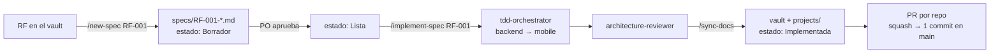
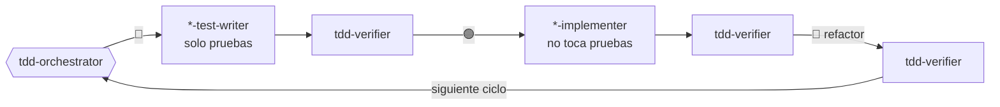

# waggo-workspace

Centro de trabajo de **Waggo — Plataforma Inteligente para Paseo Seguro de Perros**. No contiene código de producto. Contiene todo lo que coordina a los repos:

| Carpeta | Qué contiene |
|---|---|
| `specs/` | Especificaciones por requerimiento (RF): contrato, tabla de ejemplos y plan TDD. Se escriben **antes** del código. |
| `.claude/agents/` | Subagentes de Claude Code con un rol cada uno (analista, dev backend, dev mobile, revisor, documentación). |
| `.claude/skills/` | Flujos reutilizables que se invocan como `/comando` (`/new-spec`, `/implement-spec`, `/sync-docs`...). |
| `.claude/settings.json` | Permisos compartidos y acceso a los repos hermanos. |
| `projects/` | README de cada repo, copiados desde el repo con `scripts/sync-readmes.ps1`. |
| `.claude/rules/` | Checklists del backend y de mobile: dónde va cada archivo y qué debe cumplir un cambio. Los agentes las leen antes de trabajar. |
| `.claude/hooks/` | Guardia TDD que separa los roles de los agentes. |
| `scripts/` | Lanzador de Claude, sincronización de READMEs y configuración de GitHub. |

## Estructura esperada en disco
```text
source/
├─ Vault Waggo/                 # Obsidian: visión, RF/RNF, arquitectura, ADR, roadmap
└─ repos/Waggo/
   ├─ waggo-workspace/          # ← este repo
   ├─ waggo-api/                # Faebb/waggo-api
   └─ waggo-mobile/             # Faebb/waggo-mobile
```

## Cómo trabajar con Claude Code
Abre Claude **desde este repo**, así se cargan los agentes, las skills y el `CLAUDE.md`:

```powershell
cd source\repos\Waggo\waggo-workspace
.\scripts\claude-waggo.ps1        # claude + --add-dir de waggo-api, waggo-mobile y el vault
```

`.claude/settings.json` también declara los repos en `additionalDirectories`, así que un `claude` normal desde aquí puede leer y editar los repos hermanos (después de aceptar la confianza del workspace). El lanzador además añade el vault.

Desde dentro de un repo puedes traer las skills y los agentes del workspace con:
```powershell
claude --add-dir ..\waggo-workspace
```

## Flujo de un requerimiento


## TDD con agentes
Cada fase la hace un agente distinto: **quien escribe la prueba no es quien la hace pasar**. El hook `.claude/hooks/tdd-guard.js` bloquea las ediciones fuera del rol de cada agente.



## Skills disponibles
| Comando | Qué hace |
|---|---|
| `/workspace-status` | Rama, cambios y últimos commits de los dos repos. |
| `/new-spec RF-XXX` | Crea la spec de un RF a partir del vault, con tabla de ejemplos y contrato. |
| `/implement-spec RF-XXX` | Implementa una spec aprobada con TDD (orquestador), revisión, docs y título del PR. |
| `/tdd api|mobile "comportamiento"` | Ciclos TDD para un cambio puntual o un bug, sin spec completa. |
| `/api-contract-change` | Guía un cambio del contrato `/api/v1` coordinado en ambos repos. |
| `/new-adr "título"` | Registra una decisión de arquitectura en el vault. |
| `/sync-docs` | Actualiza el vault y los README de `projects/` con lo implementado. |

## Subagentes
| Agente | Rol | Puede escribir |
|---|---|---|
| `requirements-analyst` | Convierte un RF en spec con ejemplos concretos. | `specs/` |
| `tdd/tdd-orchestrator` | Planea los ciclos outside-in y coordina cada fase. | Nada (delega) |
| `tdd/backend-test-writer` | 🔴 Pruebas xUnit en `waggo-api/Tests/`. | Solo pruebas (hook) |
| `tdd/mobile-test-writer` | 🔴 Pruebas Jest + RNTL en `waggo-mobile/src`. | Solo pruebas (hook) |
| `tdd/backend-implementer` | 🟢🔵 Código mínimo + refactor en `waggo-api`. | Todo menos pruebas (hook) |
| `tdd/mobile-implementer` | 🟢🔵 Código mínimo + refactor en `waggo-mobile`. | Todo menos pruebas (hook) |
| `tdd/tdd-verifier` | ⚖️ Certifica cada fase: rojo por la razón correcta, verde real, archivos dentro del rol. | Nada |
| `architecture-reviewer` | Revisa cambios contra ADR, capas y Definition of Done. | Nada |
| `docs-keeper` | Mantiene sincronizados el vault y `projects/`. | Solo docs |

## Integración: squash and merge
Cada PR entra a `main` como **un solo commit** cuyo mensaje es el título del PR. Los commits `test` → `feat` → `refactor` quedan en la rama como evidencia del TDD.

- El título del PR sigue Conventional Commits: `feat(pricing): quote fare by walk type (RF-019)`. Lo valida `.github/workflows/pr-title.yml` en cada repo.
- `scripts/configure-github.ps1` configura GitHub cuando existan los repos: solo squash, título del PR como mensaje, borrado de ramas y protección de `main`. Prueba primero con `-DryRun`; usa `-Approvals 0` mientras haya un solo desarrollador.
- Detalle: vault → `03 Desarrollo/Convenciones de Git y ramas.md`.

## Repos
- Backend: [Faebb/waggo-api](https://github.com/Faebb/waggo-api) · resumen en [`projects/waggo-api`](projects/waggo-api/README.md)
- Mobile: [Faebb/waggo-mobile](https://github.com/Faebb/waggo-mobile) · resumen en [`projects/waggo-mobile`](projects/waggo-mobile/README.md)
