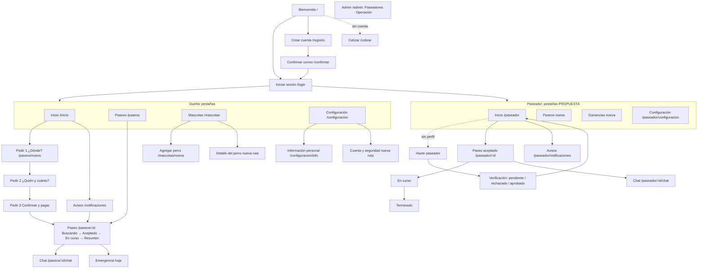

# 05 — Flujos y navegación

> Rutas actuales: `waggo-mobile/src/app`. Pestañas: ADR-019 (citado en `_layout.tsx`; la nota del vault no estaba disponible). Pantallas: ver `06-inventario-de-pantallas.md`.

## Mapa de navegación por rol

Reglas:
- Las pestañas solo se ven en las cuatro pantallas raíz de cada rol; las de detalle se apilan encima y la ocultan (ADR-019).
- **PROPUESTA (rompe ADR-019)**: el paseador pasa de 2 pestañas (Inicio, Configuración) a 4 (Inicio, Paseos, Ganancias, Configuración). Hoy "Tus paseos" y las ganancias viven dentro del inicio, que se vuelve largo justo donde está el mapa. Decisión del PO.
- El admin entra por un enlace visible solo con rol `admin` (spec del panel, ejemplo 1); no tiene pestañas propias. En tablet y web usa el diseño de dos columnas (`admin-operacion-tablet-web.svg`).
- Una misma cuenta puede ser dueño y paseador: "Usar Waggo como dueño" / "Quiero ser paseador" en Configuración cambian de modo sin cerrar sesión (hoy se decide por la ruta).

## Flujos de extremo a extremo

### 1. Reservar un paseo (dueño) — RF-007, RF-019, RF-015
1. Inicio → "¿Quién sale a pasear hoy?".
2. **¿Dónde?**: mapa con pin en mi ubicación (si hay permiso) o búsqueda. Ajusto el pin → "Confirmar recogida".
3. **¿Quién y cuánto?**: perros (1–3), tipo, duración, cuándo, indicaciones. El total se actualiza en vivo en el pie.
4. **Confirmar y pagar**: resumen, desglose, método de pago, frase de escrow → "Pedir paseo · $ 23.000".
5. Si la pasarela rechaza: banner en la misma pantalla, el paseo no se crea (RF-015 ejemplo 2).
6. Pasa a **Buscando paseador** (mapa con pulso en la recogida).
Errores en cada paso: ver `07` (sin perros, sin ubicación, dirección inválida, horario fuera de rango).

### 2. Aceptar y hacer un paseo (paseador) — RF-006, RF-007, RF-008, RF-011, RF-017
1. Inicio: mapa con solicitudes (píldoras de precio) + lista en el sheet, de la más cercana a la más lejana (radio 5 km ⚠️ provisional).
2. "Aceptar" en la tarjeta. Si otro la tomó: banner y la tarjeta queda "Ya no disponible" (409).
3. **Paseo aceptado**: ruta pendiente a la recogida, ETA, "Abrir en Maps", indicaciones, datos del perro.
4. "Iniciar paseo" al tener al perro → **En curso**: comparte ubicación cada ~15 s; zona acordada en el mapa; SOS.
5. "Terminar paseo" → hoja de confirmación (con aviso si está lejos de la recogida) → **Terminado**: "Ganaste $ 18.400 · Pagado a tu cuenta".

### 3. Seguimiento en vivo (dueño) — RF-008, RF-014
Buscando → (aviso "Tu paseo fue aceptado") → Aceptado: tarjeta del paseador verificado + chat → (aviso "Tu paseo empezó") → **En vivo**: mapa a pantalla completa, sheet en tres alturas, métricas, hora de la última posición → (aviso "Tu paseo terminó") → **Resumen** con ruta completa y "Pagado".

### 4. Emergencia — RF-012, RF-014
Quien la levanta: SOS en el mapa → hoja "¿Es una emergencia?" (tipo + mensaje opcional) → "Sí, es una emergencia" → banner fijo rojo "Reportaste una emergencia" + llamar al 123 / escribir.
Quien la recibe: aviso de prioridad alta + banner fijo rojo y marcador de alerta en el mapa; se anuncia al lector de pantalla de forma asertiva. El admin la ve en **Operación**.
Automáticas (RF-009/010): "Salió de la zona" (rojo) y "Detenido 10 min" (ámbar) con las mismas acciones.

### 5. Pago — RF-015 a RF-018
Retenido al pedir → Liberado si se cancela antes de empezar → Cobrado al terminar. El dueño lo ve en el sheet del paseo y en el resumen; el paseador en la tarjeta, al terminar y en Ganancias.

### 6. Onboarding del paseador — RF-002, RF-003
Configuración o Bienvenida → "Quiero ser paseador" → formulario → **Verificando** (línea de tiempo) → aviso al aprobar → **Aprobado** → Inicio con solicitudes. Rechazado: motivo + "Escribir a soporte" (⚠️ ¿puede reintentar? pregunta abierta).

### 7. Verificación por el admin — RF-002, RF-003 (panel, slice 1)
Admin → Paseadores pendientes → "Aprobar" (toast y sale de la cola) o "Rechazar" → hoja con motivo (motivo opcional) → sale de la cola.
