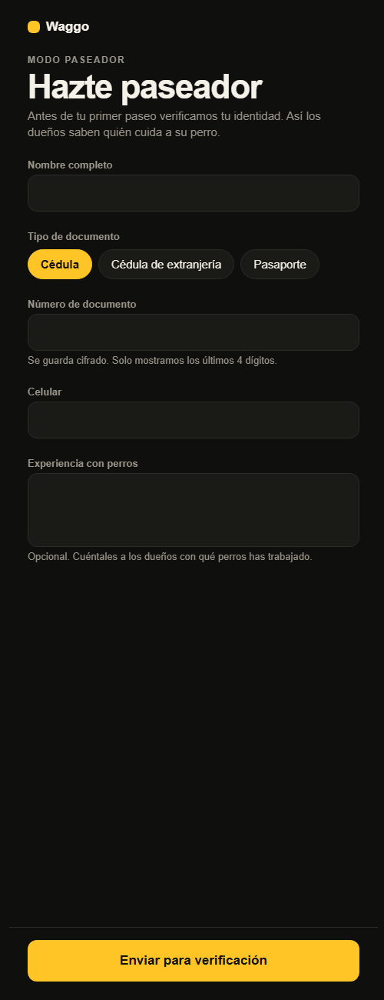
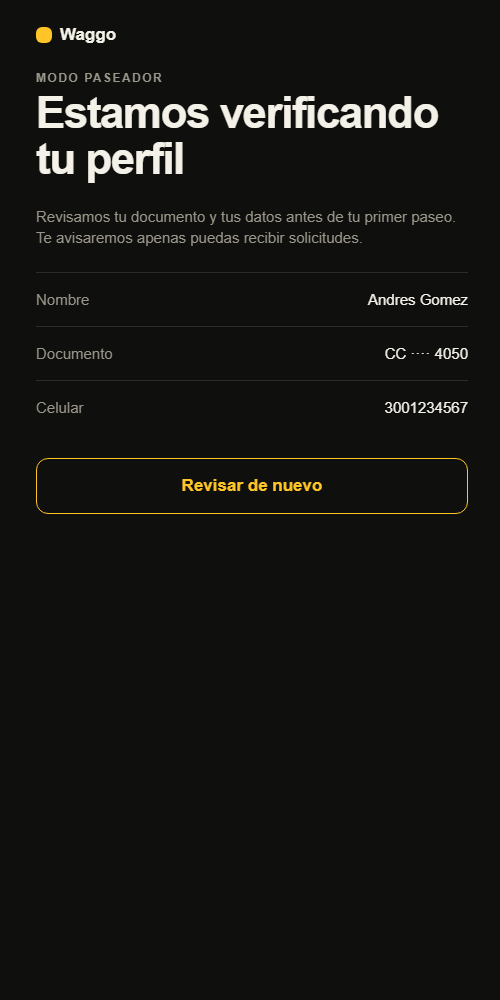
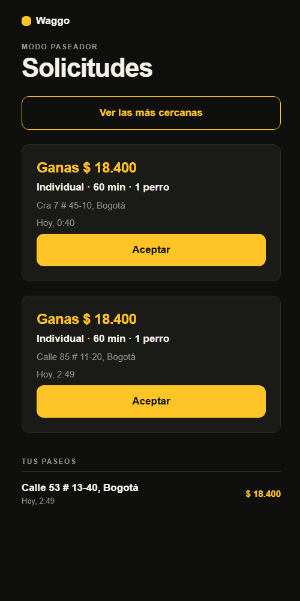

# RF-002 + RF-003 — Paseadores verificados

> Vault: `01 Proyecto/Requerimientos funcionales.md` (RF-002, RF-003), `Actores y roles.md`, RNF-003 · Roadmap: sprint 2 · Completa la mitad pendiente de RF-006

El pilar de Waggo es la **confianza**: solo paseadores verificados reciben paseos. El paseador crea su perfil con sus datos y su documento (**cifrado**, RNF-003) y queda **pendiente de verificación**. Mientras no se elija el proveedor de biometría y antecedentes, la verificación la hace un **administrador** a mano (aprobar o rechazar con motivo). Solo un paseador **aprobado** ve solicitudes y puede aceptarlas.

> [!note] Decisiones asumidas por el desarrollador
> - La cuenta en sí (login) llega con RF-001/RF-005; hoy el paseador es el usuario del token (en desarrollo, `dev-walker`).
> - **Verificación manual** como sustituto del proveedor (pregunta abierta del roadmap): `POST /admin/walkers/{id}/approve|reject`. Cuando se elija el proveedor, su webhook llamará a la misma lógica.
> - La **foto** y la imagen del documento necesitan almacenamiento de archivos: quedan para un slice propio. Hoy se guardan los datos del documento.

## Historias de usuario
- Como **paseador** quiero **registrarme con mis datos y mi documento** para **que Waggo me verifique y me deje recibir paseos**.
- Como **administrador** quiero **aprobar o rechazar a los paseadores pendientes** para **que solo personas verificadas pasen perros**.

## Criterios de aceptación
- [x] El paseador crea su perfil (nombre, tipo y número de documento, teléfono, experiencia opcional); queda `Pending`.
- [x] El número de documento se guarda cifrado; el paseador ve solo los últimos 4 dígitos.
- [x] Un paseador tiene un solo perfil (409 si lo intenta dos veces).
- [x] El administrador lista los pendientes y aprueba o rechaza (con motivo) a cada uno.
- [x] Solo un paseador `Approved` ve solicitudes (`GET /walks/available`) y acepta paseos; si no, 403 `Walkers.NotVerified`.

## Tabla de ejemplos
| # | Entrada | Resultado esperado | Tipo |
|---|---|---|---|
| 1 | `POST /walkers/me` `{ fullName: "Andrés Gómez", documentType: "CC", documentNumber: "1020304050", phone: "3001234567", experience: "3 años con perros grandes" }` | 200; `status: Pending`, `documentLast4: "4050"` | Feliz |
| 2 | `GET /walkers/me` | El perfil con su estado | Feliz |
| 3 | Crear el perfil otra vez | 409 `Walkers.AlreadyRegistered` | Conflicto |
| 4 | Nombre vacío, documento con letras o teléfono de 5 dígitos | 400 `Walkers.InvalidFullName` / `InvalidDocument` / `InvalidPhone` | Error |
| 5 | Columna `document_number` en la base de datos | No contiene "1020304050" | RNF-003 |
| 6 | Admin `GET /admin/walkers?status=Pending` | Lista de pendientes | Feliz |
| 7 | Admin `POST /admin/walkers/{id}/approve` | `status: Approved` | Feliz |
| 8 | Admin `POST /admin/walkers/{id}/reject` `{ reason: "Documento ilegible" }` | `status: Rejected`, con motivo | Feliz |
| 9 | Paseador pendiente consulta `GET /walks/available` o acepta | 403 `Walkers.NotVerified` | Regla |
| 10 | Paseador aprobado consulta `available` | 200 | Feliz |
| 11 | Un paseador (no admin) intenta aprobar | 403 `Auth.Forbidden` | Autorización |

## Reglas de negocio
| Regla | Valor | Origen |
|---|---|---|
| Nombre completo | 3–100 caracteres | ⚠️ provisional |
| Documento | `CC`, `CE` o `PP`; 5–15 dígitos (pasaporte: 5–15 letras o dígitos) | ⚠️ provisional (Colombia) |
| Teléfono | 10 dígitos (celular colombiano) | ⚠️ provisional |
| Experiencia | Opcional, hasta 500 caracteres | ⚠️ provisional |
| Motivo de rechazo | 5–300 caracteres | ⚠️ provisional |

## Diseño
- **Domain**: `Entities/Walkers/WalkerProfile` (`Register`, `Approve`, `Reject`), `Enums/Walkers/{VerificationStatus, DocumentType}`, `Errors/Walkers/WalkerErrors`.
- **Application**: `Walkers/Commands/{RegisterWalker, ApproveWalker, RejectWalker}`, `Walkers/Queries/{GetMyWalkerProfile, ListWalkersForReview}`, `IWalkerProfileRepository`; `ListAvailableWalks` y `AcceptWalk` exigen paseador aprobado.
- **Infrastructure**: `identity.walker_profiles` con `document_number` cifrado (`EncryptedStringConverter`), migración `AddWalkerProfiles`.
- **Api**: `Endpoints/Walkers/WalkersEndpoints` con dos grupos: `/walkers/me` (política walker) y `/admin/walkers` (política admin). Validación de la petición en `RegisterWalkerRequestValidator` (campos obligatorios y tipo de documento); los formatos los valida el dominio.
- **Mobile**: `features/walker` — `WalkerGate` envuelve `/paseador`: sin perfil muestra `BecomeWalkerScreen` ("Hazte paseador"), pendiente muestra "Estamos verificando tu perfil" (se revisa cada 30 s y con "Revisar de nuevo"), rechazado muestra "No pudimos verificar tu perfil" con el motivo, y aprobado deja pasar a las solicitudes. El formulario quita puntos del documento y espacios del celular antes de enviar (`walkerForm`).

| Hazte paseador | Verificando | Aprobado |
|---|---|---|
|  |  |  |

## Preguntas abiertas para el PO
- [ ] Proveedor de verificación de identidad y antecedentes (ya en el roadmap).
- [ ] ¿Qué documentos se aceptan? ¿Hace falta foto del paseador y del documento?
- [ ] ¿Un paseador rechazado puede volver a intentarlo?

## Trazabilidad
| Repo | Archivos | Pruebas |
|---|---|---|
| waggo-api | `Entities/Walkers/WalkerProfile`, `Enums/Walkers/{VerificationStatus, DocumentType}`, `Errors/Walkers/WalkerErrors`; `Walkers/Commands/{RegisterWalker, ApproveWalker, RejectWalker}`, `Walkers/Queries/{GetMyWalkerProfile, ListWalkersForReview}`, `Walkers/WalkerVerification` (usado por `AcceptWalk` y `ListAvailableWalks`), `IWalkerProfileRepository`; `WalkerProfileConfiguration`, `WalkerProfileRepository`, migración `AddWalkerProfiles`; `Endpoints/Walkers` | `WalkerProfileEndpointTests` (ejemplos 1–11), `WalkerProfileTests`; `WalkScenario.VerifiedWalkerAsync` en las pruebas de paseos; `WalkerMother` en las unitarias |
| waggo-mobile | `src/features/walker/{api/walkerProfileApi, hooks/useWalkerProfile, model/{types, walkerForm}, components/WalkerGate, screens/BecomeWalkerScreen}`, `app/paseador/index.tsx` | `walkerProfileApi.test.ts`, `walkerForm.test.ts`, `WalkerGate.test.tsx`, `BecomeWalkerScreen.test.tsx` |
