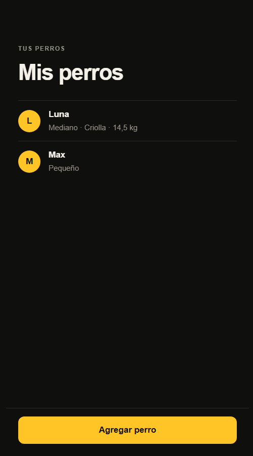
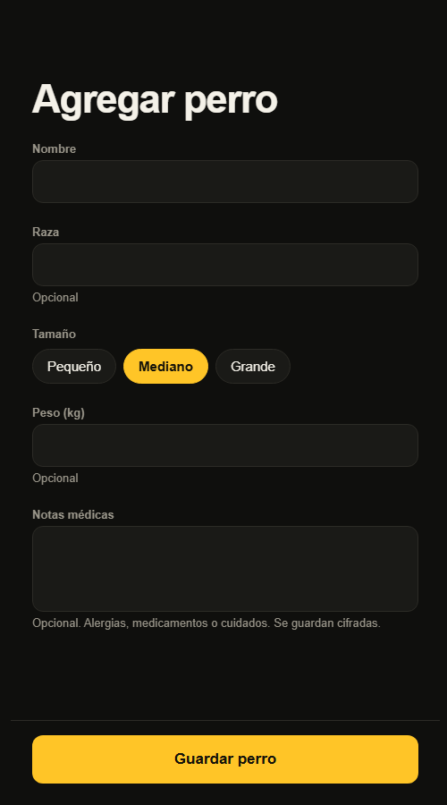

# RF-004 — Perfil de mascota

> Vault: `01 Proyecto/Requerimientos funcionales.md` · `02 Arquitectura/Base de datos - PostgreSQL.md` · Roadmap: sprint 3 (se adelanta porque la solicitud de paseo, RF-007, necesita elegir un perro)

Primer módulo con persistencia. Deja el patrón para los siguientes: entidad en Domain, repositorio en Infrastructure, migraciones de EF Core, `snake_case` y un schema por módulo (`pets`).

> [!note] Decisiones asumidas por el desarrollador
> El PO no la ha validado todavía. Los campos, límites y el tope de perros son propuestas y quedan como preguntas abiertas.

## Historia de usuario
Como **dueño** quiero **registrar a mis perros con sus datos y su historial médico** para **no repetirlos cada vez que pida un paseo y que el paseador sepa cómo cuidarlos**.

## Criterios de aceptación
- [x] El dueño registra uno o más perros: nombre, raza (opcional), tamaño, fecha de nacimiento (opcional), peso (opcional) y notas médicas (opcional).
- [x] El dueño ve la lista de **sus** perros y el detalle de cada uno. Nunca ve los de otro dueño.
- [x] Las notas médicas se guardan **cifradas** en la base de datos (RNF-003) y se muestran descifradas solo a su dueño.
- [x] Los datos inválidos se rechazan con errores identificables y mensajes en español que explican cómo corregirlos.

## Tabla de ejemplos
| # | Entrada | Resultado esperado | Tipo |
|---|---|---|---|
| 1 | `POST /pets` `{ name: "Luna", breed: "Criolla", size: "Medium", birthDate: "2021-05-10", weightKg: 14.5, medicalNotes: "Alérgica al pollo" }` | 200 con el perro creado (`id`, datos y `medicalNotes`) | Feliz |
| 2 | `POST /pets` solo con `name: "Max"` y `size: "Small"` | 200; `breed`, `birthDate`, `weightKg` y `medicalNotes` en `null` | Límite: mínimos |
| 3 | `GET /pets` después de registrar a Luna y Max | 200 con los dos perros del dueño, ordenados por nombre | Feliz |
| 4 | `GET /pets` de otro dueño | 200 con lista vacía (no ve los perros ajenos) | Seguridad |
| 5 | `GET /pets/{id}` de un perro propio | 200 con el detalle y las notas médicas descifradas | Feliz |
| 6 | `GET /pets/{id}` de un perro ajeno o inexistente | 404 `Pets.NotFound` | Error |
| 7 | Columna `medical_notes` en la base de datos | No contiene el texto plano "Alérgica al pollo" | RNF-003 |
| 8 | `POST /pets` sin `name` | 400 `Request.Required` | Error capa 1 |
| 9 | `POST /pets` con `size: "Giant"` | 400 `Request.InvalidValue` | Error capa 1 |
| 10 | `POST /pets` con `name` de 51 caracteres | 400 `Pets.InvalidName` | Error capa 2 |
| 11 | `POST /pets` con `weightKg: 0.2` o `120` | 400 `Pets.InvalidWeight` | Error capa 2 |
| 12 | `POST /pets` con `birthDate` en el futuro | 400 `Pets.InvalidBirthDate` | Error capa 2 |
| 13 | El dueño ya tiene 10 perros y registra otro | 422 `Pets.LimitReached` | Regla de negocio |
| 14 | `POST /pets` con rol `walker` | 403 `Auth.Forbidden` | Autorización |

## Reglas de negocio
| Regla | Valor | Origen |
|---|---|---|
| Nombre | 1–50 caracteres, sin espacios al inicio o al final | ⚠️ provisional |
| Raza | Opcional, hasta 50 caracteres | ⚠️ provisional |
| Tamaño | `Small` (< 10 kg), `Medium` (10–25 kg), `Large` (> 25 kg) | ⚠️ provisional |
| Fecha de nacimiento | Opcional; no futura y no anterior a 30 años | ⚠️ provisional |
| Peso | Opcional; 0,5–100 kg | ⚠️ provisional |
| Notas médicas | Opcional; hasta 2.000 caracteres; **cifradas** en reposo (AES-256-GCM) | RNF-003 |
| Perros por dueño | Máximo 10 | ⚠️ provisional |

## Contrato de API
Autorización: `WaggoPolicies.Owner` (owner o admin) en los tres endpoints. El dueño es el usuario autenticado (`sub` del token; en desarrollo, el usuario de desarrollo).

`POST /api/v1/pets` — body:
```json
{ "name": "Luna", "breed": "Criolla", "size": "Medium", "birthDate": "2021-05-10", "weightKg": 14.5, "medicalNotes": "Alérgica al pollo" }
```
`GET /api/v1/pets` — lista de los perros del dueño (sin paginar: el máximo es 10).
`GET /api/v1/pets/{id}` — detalle.

Respuesta de un perro (`PetResponse`):
```json
{ "id": "0b3c…", "name": "Luna", "breed": "Criolla", "size": "Medium", "birthDate": "2021-05-10",
  "weightKg": 14.5, "medicalNotes": "Alérgica al pollo" }
```

### Validación capa 1 — DTO (`RegisterPetRequestValidator`)
| Campo | Regla | `code` |
|---|---|---|
| `name` | Obligatorio | `Request.Required` |
| `size` | Obligatorio; uno de `Small`, `Medium`, `Large` | `Request.Required` / `Request.InvalidValue` |

### Validación capa 2 — negocio (`RegisterPetCommandValidator` y la entidad `Pet`)
| Regla | `code` | HTTP |
|---|---|---|
| Nombre 1–50 | `Pets.InvalidName` | 400 |
| Raza ≤ 50 | `Pets.InvalidBreed` | 400 |
| Peso 0,5–100 | `Pets.InvalidWeight` | 400 |
| Fecha de nacimiento válida | `Pets.InvalidBirthDate` | 400 |
| Notas médicas ≤ 2.000 | `Pets.InvalidMedicalNotes` | 400 |
| Máximo 10 perros por dueño | `Pets.LimitReached` | 422 |

### Excepciones
`NotFoundException(PetErrors.NotFound)` → 404 cuando el perro no existe o es de otro dueño (no se revela cuál de los dos).

## Diseño
- **Domain**: `Entities/Pets/Pet` (factory `Pet.Register(...)` → `WaggoResponse<Pet>` con las invariantes), `Enums/Pets/PetSize`, `Errors/Pets/PetErrors`.
- **Application**: `Common/Interfaces/ICurrentUser` (id y roles del usuario actual), `Common/Interfaces/Pets/IPetRepository`; `Pets/Commands/RegisterPet/*`, `Pets/Queries/ListMyPets/*`, `Pets/Queries/GetPet/*`, `Pets/PetResponse`. La fecha actual llega por `TimeProvider`.
- **Infrastructure**: `Persistence/Configurations/Pets/PetConfiguration` (schema `pets`, tabla `pets`, `snake_case` con `EFCore.NamingConventions`), `Persistence/Migrations/`, `Services/Pets/PetRepository`, `Services/Security/AesGcmFieldEncryptor` + `EncryptedStringConverter`, `Options/Security/EncryptionOptions` (`Encryption:Key`, base64 de 32 bytes, validada al arrancar).
- **Api**: `Endpoints/Pets/{PetsEndpoints, Requests/RegisterPetRequest, Validators/RegisterPetRequestValidator}`, `Infrastructure/Authentication/HttpCurrentUser`. Las migraciones se aplican al arrancar en `Development` y `Testing`.
- **Mobile**: `features/pets/{api/petsApi, hooks/usePets (useMyPets, useRegisterPet), components/PetRow, screens/{MyPetsScreen, AddPetScreen}, model/{types, describePet, petForm}}`; `shared/api/httpClient.post`, `shared/ui/{TextField, ActionFooter}` y `layout.column` en el tema. Rutas `/mascotas` y `/mascotas/nueva`; la bienvenida suma el botón secundario "Mis perros".
- El formulario de mobile pide la fecha de nacimiento como texto "DD/MM/AAAA" (`shared/ui/DateField`); el selector nativo queda pendiente de aprobar la dependencia (ver cambio posterior 2026-10-27).
- El formulario solo valida lo que el dueño puede corregir antes de enviar (nombre vacío, peso que no es número). Las reglas de negocio las valida la API y sus mensajes se muestran tal como llegan.

| Mis perros | Agregar perro |
|---|---|
|  |  |

## RNF aplicables
| RNF | Cómo se cumple | Prueba |
|---|---|---|
| RNF-003 | Notas médicas cifradas por columna con AES-256-GCM (value converter); llave en configuración | `AesGcmFieldEncryptorTests`, ejemplo 7 (integración) |
| RNF-009 | Carpetas por tipo con subcarpeta `Pets/`; schema `pets` | `LayerTests` |

## Plan TDD
**Backend** (de afuera hacia adentro):
1. `PetsEndpointTests` (integración, ejemplos 1–9, 13, 14) — rojo.
2. `PetTests` (dominio, ejemplos 10–12) → `Pet`, `PetErrors`, `PetSize`.
3. `AesGcmFieldEncryptorTests` → cifrador.
4. `RegisterPetHandlerTests`, `ListMyPetsHandlerTests`, `GetPetHandlerTests` (NSubstitute) → handlers.
5. `RegisterPetRequestValidatorTests` → validador DTO.

**Mobile**:
1. `petsApi.test.ts` (esquemas Zod).
2. `MyPetsScreen.test.tsx`: lista, estado vacío, error.
3. `AddPetScreen.test.tsx`: envía el formulario, muestra errores de la API.
4. `TextField.test.tsx`.

## Preguntas abiertas para el PO
- [ ] ¿Qué datos del perro son obligatorios? ¿Hace falta foto (se guardaría en un almacenamiento de archivos)?
- [ ] Tamaños y rangos de peso definitivos. ¿El tamaño afecta la tarifa?
- [ ] ¿Máximo de perros por dueño?
- [ ] ¿El paseador ve las notas médicas completas del perro que va a pasear? (se resolverá con RF-007)

> [!note] Cambio posterior (propuesta de diseño, 2026-10-27)
> - **Detalle del perro** (`/mascotas/[id]`, `PetDetailScreen`) sobre el `GET /pets/{id}` existente: datos, notas médicas con candado ("Se guardan cifradas. Hoy solo tú las ves.") y "Pedir paseo con Luna", que abre pedir paseo con el perro preseleccionado.
> - **Mis perros**: tarjetas con indicador "Notas médicas privadas"; vacío "Aún no tienes perros" + "Agregar mi primer perro"; error con "Intentar de nuevo".
> - **Agregar perro**: `Pets.InvalidName` y `Pets.InvalidWeight` se muestran bajo su campo; `Pets.LimitReached` en aviso ámbar y el botón queda deshabilitado.
> - **Pendiente**: fecha de nacimiento con selector nativo (necesita una dependencia de selector de fecha), rangos de peso en los chips y el contador "2 de 10" (valores ⚠️ provisionales).

> [!note] Cambio posterior (cierre de diferencias con la propuesta, 2026-10-27)
> - **Fecha de nacimiento**: campo "Nacimiento" (opcional) con `shared/ui/DateField`, un campo de texto que escribe "DD/MM/AAAA" sobre teclado numérico. **No es el selector nativo** del diseño: ese necesita `@react-native-community/datetimepicker` (dependencia nueva, decisión del PO). El front rechaza fechas que no existen ("Escribe una fecha real, por ejemplo 10/05/2021.") o futuras ("La fecha de nacimiento no puede ser futura."); el límite de 30 años lo valida la API (`Pets.InvalidBirthDate`, que ahora se muestra bajo el campo). Se envía como `birthDate: "2021-05-10"`. El detalle muestra "10/05/2021".
> - **Chips de tamaño** con rango: "Pequeño · <10 kg", "Mediano · 10–25 kg", "Grande · >25 kg" (⚠️ provisional, `PET_SIZE_CHIP_LABELS`).
> - **Contador** "2 de 10 perros" bajo el título de Mis perros (`MAX_PETS_PER_OWNER = 10`, ⚠️ provisional, igual a `Pet.MaxPetsPerOwner`). Vacío con el copy del diseño: "Agrégalos una vez y elígelos en segundos cada vez que pidas un paseo."
> - Pruebas: `AddPetScreen.test.tsx` (fecha válida, inválida, futura y `Pets.InvalidBirthDate`), `MyPetsScreen.test.tsx` (contador), `PetDetailScreen.test.tsx` (fecha), `DateField.test.tsx`.

## Trazabilidad
| Repo | Archivos | Pruebas |
|---|---|---|
| waggo-api | `Waggo.Domain/{Entities,Enums,Errors}/Pets/*`, `Waggo.Application/Common/Interfaces/{ICurrentUser, Pets/IPetRepository}`, `Waggo.Application/Pets/{PetResponse, Commands/RegisterPet/*, Queries/ListMyPets/*, Queries/GetPet/*}`, `Waggo.Infrastructure/{Persistence/Configurations/Pets/PetConfiguration, Persistence/Converters/EncryptedStringConverter, Persistence/Context/{WaggoDbContext, WaggoDbContextFactory}, Persistence/Migrations/*_AddPets, Services/Pets/PetRepository, Services/Security/AesGcmFieldEncryptor, Options/Security/EncryptionOptions}`, `Waggo.Api/{Endpoints/Pets/*, Infrastructure/Authentication/HttpCurrentUser}` | `Tests/Waggo.Api.IntegrationTests/Endpoints/Pets/PetsEndpointTests` (ejemplos 1–9, 11, 13, 14), `Tests/Waggo.Domain.UnitTests/Entities/Pets/PetTests` (10–12), `Tests/Waggo.Application.UnitTests/Pets/**`, `Tests/Waggo.Api.UnitTests/Endpoints/Pets/Validators/RegisterPetRequestValidatorTests`, `Tests/Waggo.Infrastructure.UnitTests/Services/Security/AesGcmFieldEncryptorTests` (RNF-003) |
| waggo-mobile | `src/features/pets/**`, `src/shared/api/httpClient.ts` (`post`), `src/shared/ui/{TextField, ActionFooter}.tsx`, `src/app/mascotas/{index, nueva}.tsx`, `src/features/onboarding/screens/WelcomeScreen.tsx` (botón "Mis perros") | `petsApi.test.ts`, `MyPetsScreen.test.tsx`, `AddPetScreen.test.tsx`, `describePet.test.ts`, `TextField.test.tsx`, `httpClient.test.ts` (`post`), `WelcomeScreen.test.tsx` |
