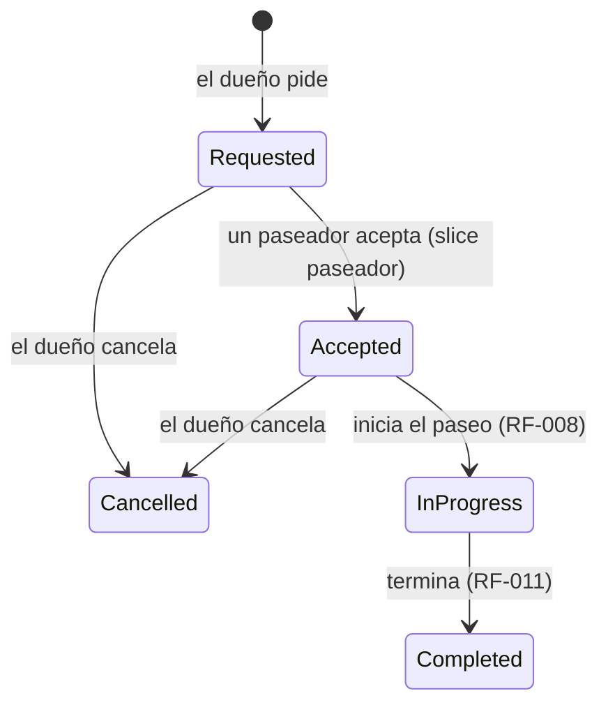

# RF-007 (slice dueño) — Pedir un paseo

> Vault: `01 Proyecto/Requerimientos funcionales.md` · `02 Arquitectura/Base de datos - PostgreSQL.md` · Roadmap: sprint 3 · Depende de RF-004 (mascotas) y RF-019 (tarifa)

Primer slice de RF-007, **inspirado en Uber**: el dueño elige a sus perros, el tipo y la duración, el punto de recogida y la hora, ve el precio y pide. La solicitud queda **buscando paseador**. El paseador la acepta en el siguiente slice (`RF-007-solicitud-de-paseo-paseador.md`).

> [!note] Decisiones asumidas por el desarrollador
> El PO no la ha validado todavía. Límites, estados y reglas de cancelación son propuestas y quedan como preguntas abiertas.

## Historia de usuario
Como **dueño** quiero **pedir un paseo para mis perros desde donde estoy, ahora o a una hora programada, viendo el precio antes de confirmar** para **resolverlo en segundos, como pedir un Uber**.

## Criterios de aceptación
- [x] El dueño pide un paseo con 1 a 3 de **sus** perros, tipo, duración, dirección y coordenadas de recogida, hora (ahora o programada) e indicaciones opcionales.
- [x] El precio se calcula con la tarifa vigente (RF-019) y **queda congelado** en el paseo.
- [x] El paseo nace en estado `Requested` (buscando paseador).
- [x] El dueño ve sus paseos (el más reciente primero) y el detalle de cada uno. Nunca ve los de otro dueño.
- [x] El dueño cancela un paseo mientras esté `Requested` o `Accepted`.

## Ciclo de vida


## Tabla de ejemplos
| # | Entrada | Resultado esperado | Tipo |
|---|---|---|---|
| 1 | `POST /walks` con Luna, `Individual`, 60 min, "Cra 7 # 45-10, Bogotá" (4.6361, -74.0645), sin hora | 200; `status: Requested`, `scheduledFor` ≈ ahora, `total: 23000`, `commission: 4600`, `walkerPayout: 18400` | Feliz |
| 2 | Igual, con Luna y Max, `Group`, 45 min, programado para mañana 8:00 | 200; `total: 11800`, `scheduledFor` = mañana 8:00 | Feliz |
| 3 | `GET /walks` tras pedir dos paseos | 200 con los dos, el más reciente primero | Feliz |
| 4 | `GET /walks` de otro dueño | 200 con lista vacía | Seguridad |
| 5 | `GET /walks/{id}` de un paseo ajeno o inexistente | 404 `Walks.NotFound` | Error |
| 6 | `POST /walks/{id}/cancel` de un paseo `Requested` | 200; `status: Cancelled` | Feliz |
| 7 | Cancelar un paseo ya cancelado | 422 `Walks.CannotCancel` | Regla de negocio |
| 8 | `POST /walks` con un perro de otro dueño | 400 `Walks.InvalidPets` | Error capa 2 |
| 9 | `POST /walks` con 4 perros | 400 `Walks.InvalidPets` | Límite |
| 10 | `POST /walks` con 50 minutos | 400 `Pricing.InvalidDuration` | Error capa 2 |
| 11 | `POST /walks` programado para dentro de 6 días o para ayer | 400 `Walks.InvalidSchedule` | Error capa 2 |
| 12 | `POST /walks` con latitud 95 | 400 `Walks.InvalidLocation` | Error capa 2 |
| 13 | `POST /walks` sin `petIds` o sin dirección | 400 `Request.Required` | Error capa 1 |
| 14 | `POST /walks` con rol `walker` | 403 `Auth.Forbidden` | Autorización |

## Reglas de negocio
| Regla | Valor | Origen |
|---|---|---|
| Perros por paseo | 1 a 3, distintos, todos del dueño | ⚠️ provisional |
| Duración | La de RF-019: 30–120 min, múltiplos de 15 | RF-019 |
| Hora | Vacía = ahora; si se programa, entre ahora y 5 días (`Walk.MaxDaysAhead`; antes 14: la autorización de la tarjeta podría vencer antes del paseo) | ⚠️ provisional |
| Dirección | 5–200 caracteres | ⚠️ provisional |
| Indicaciones | Opcional, hasta 500 caracteres ("timbre dañado, llamar al llegar") | ⚠️ provisional |
| Precio | Tarifa vigente al pedir; no cambia si la tarifa cambia después | Uber |
| Cancelación | Gratis en `Requested` y `Accepted`; no se puede en `InProgress`, `Completed` ni `Cancelled` | ⚠️ provisional (¿cobro por cancelación tardía?) |

## Contrato de API
Autorización: `WaggoPolicies.Owner`.

`POST /api/v1/walks`:
```json
{ "petIds": ["…"], "walkType": "Individual", "durationMinutes": 60,
  "pickupAddress": "Cra 7 # 45-10, Bogotá", "latitude": 4.6361, "longitude": -74.0645,
  "scheduledFor": null, "notes": "Timbre dañado, llamar al llegar" }
```
`GET /api/v1/walks` · `GET /api/v1/walks/{id}` · `POST /api/v1/walks/{id}/cancel`

Respuesta (`WalkResponse`):
```json
{ "id": "…", "status": "Requested", "petIds": ["…"], "walkType": "Individual", "durationMinutes": 60,
  "pickupAddress": "Cra 7 # 45-10, Bogotá", "latitude": 4.6361, "longitude": -74.0645,
  "scheduledFor": "2026-09-30T15:00:00+00:00", "notes": "…",
  "currency": "COP", "total": 23000, "commission": 4600, "walkerPayout": 18400,
  "walkerId": null, "requestedAt": "2026-09-30T15:00:00+00:00" }
```

### Validación capa 1 — DTO (`RequestWalkRequestValidator`)
`petIds`, `walkType`, `durationMinutes`, `pickupAddress`, `latitude` y `longitude` obligatorios (`Request.Required`); `walkType` válido (`Request.InvalidValue`).

### Validación capa 2 — negocio (`RequestWalkCommandValidator`, entidad `Walk`, handler)
| Regla | `code` | HTTP |
|---|---|---|
| 1–3 perros distintos del dueño | `Walks.InvalidPets` | 400 |
| Duración válida | `Pricing.InvalidDuration` | 400 |
| Hora entre ahora y 5 días ("Programa el paseo para ahora o para los próximos 5 días.") | `Walks.InvalidSchedule` | 400 |
| Coordenadas válidas | `Walks.InvalidLocation` | 400 |
| Dirección 5–200 | `Walks.InvalidAddress` | 400 |
| Indicaciones ≤ 500 | `Walks.InvalidNotes` | 400 |
| Cancelar solo en `Requested`/`Accepted` | `Walks.CannotCancel` | 422 |

### Excepciones
`NotFoundException(WalkErrors.NotFound)` → 404 cuando el paseo no existe o no es del dueño.

## Diseño
- **Domain**: `Entities/Walks/Walk` (`Request`, `Cancel`), `Enums/Walks/WalkStatus`, `ValueObjects/Walks/GeoPoint`, `Errors/Walks/WalkErrors`. Reusa `WalkType`, `WalkDuration` y `FareCalculator` de Pricing.
- **Application**: `Common/Interfaces/Walks/IWalkRepository`; `Walks/Commands/{RequestWalk, CancelWalk}`, `Walks/Queries/{ListMyWalks, GetWalk}`, `Walks/WalkResponse`.
- **Infrastructure**: `WalkConfiguration` (schema `walks`, `pet_ids uuid[]`, `pickup_location geography(Point, 4326)` con índice GiST), extensión `postgis`, NetTopologySuite; `WalkRepository`; migración `AddWalks`.
- **Api**: `Endpoints/Walks/{WalksEndpoints, Requests, Validators}`.
- **Mobile**: `features/walks` — `RequestWalkScreen` (`/paseos/nuevo`: perros, tipo, duración, cuándo — Ahora, En 1 hora, Mañana 8:00, Mañana 17:00 —, dirección + GPS con `expo-location`, indicaciones, total en vivo y "Pedir paseo"), `WalkStatusScreen` (`/paseos/[id]`: "Buscando paseador…" con un punto que pulsa, detalle, cancelar; se refresca cada 5 s mientras el paseo está activo), `MyWalksScreen` (`/paseos`).
- **Inicio del dueño** `features/home/HomeScreen` (`/inicio`), como una app de viajes: una entrada grande "¿Quién sale a pasear hoy?", el paseo en curso y accesos a mis perros y mis paseos. La bienvenida (UX-001) pasa a tener un solo botón, "Empezar", que lleva al inicio.
- La ubicación se pide solo al tocar "Usar mi ubicación" (permiso "mientras se usa la app"). Sin coordenadas no se puede pedir el paseo.

| Inicio | Pedir paseo | Buscando paseador | Mis paseos |
|---|---|---|---|
|  |  |  |  |

> [!note] Cambio posterior (propuesta de diseño, 2026-10-26; cambia la pantalla de pedir paseo)
> Implementado según `design/propuesta/07` · pantallas 7, 11–19, por orden del PO. **Sin cambios de API**: el cuerpo de `POST /walks` es el mismo.
> - **Pedir paseo en tres pasos** dentro de `/paseos/nuevo` (`RequestWalkScreen`): 1 · "¿Dónde recogemos a tus perros?" (dirección + "Usar mi ubicación"; sin permiso, aviso con "Abrir Ajustes"; "Confirmar recogida" pide dirección y coordenadas), 2 · "¿Quién sale y cuánto?" (perros, tipo, duración, cuándo, indicaciones, total en vivo y "Continuar"; sin perros, "Agrega a tu perro para pedir"), 3 · "Confirma tu paseo" (resumen, total con la comisión, nota de retención y "Pedir paseo · $ X"). Los errores `Walks.InvalidPets` y `Walks.InvalidSchedule` regresan al paso 2; `Payments.Declined` y el resto se muestran en el paso 3. Se puede volver al paso anterior sin perder lo elegido. El dueño puede llegar con un perro preseleccionado desde su detalle (`?petId=`).
> - **Pendiente** (no se implementó): el mapa con el pin al centro y la búsqueda de direcciones (proveedor de mapas sin decidir; el paso 1 es el estado "el mapa no carga" del diseño), "Otra fecha" (necesita selector de fecha), el método de pago "Visa •••• 4242" (marcador del diseño) y "nadie aceptó" (`nueva — requiere spec`).
> - **Inicio** (`HomeScreen`): saludo con el nombre del perfil, tarjeta del paseo actual con su estado, "¿Quién sale a pasear hoy?" en azul, "Próximos" y, en el primer uso sin perros, "Primero, cuéntanos de tu perro" + "Así funciona". Los accesos a mis perros, mis paseos y configuración se quitan porque ya están en las pestañas (ADR-019).
> - **Estado del paseo** (`WalkStatusScreen`): zona superior de mapa (ruta SVG en curso o terminado; tarjeta de recogida antes) y una tarjeta tipo *bottom sheet* con estado, titular anunciado, paseador verificado con botón de chat, seguridad y detalle. Cancelar pide confirmación ("Liberamos los $ X retenidos."). Terminado: "Luna volvió a casa", horas de recogida y entrega y "Pedir otro paseo"; cancelado: "Pedir de nuevo".
> - **Mis paseos**: secciones En curso, Programados e Historial; vacío con "Pedir un paseo"; error con "Intentar de nuevo".

> [!note] Cambio posterior (decisión del PO: mapas con OpenStreetMap, 2026-10-27)
> Cierra el pendiente del mapa del paso 1. **Sin cambios de API**: `pickupAddress`, `latitude` y `longitude` del cuerpo de `POST /walks` salen ahora del mapa. Borrador de ADR: [`_adr-borrador-mapas-openstreetmap.md`](_adr-borrador-mapas-openstreetmap.md).
> - **Paso 1 · ¿Dónde?**: mapa de OpenStreetMap con un **pin fijo al centro** (vista inicial: Colombia, zoom 7; al fijar un punto, zoom 15). La recogida se elige de tres formas: (a) **buscar** la dirección con Nominatim al tocar "Buscar" — **sin autocompletar mientras se escribe** (política de Nominatim) — y tocar un resultado; (b) "Usar mi ubicación" — si el permiso nunca se pidió, primero una explicación ("Para encontrar paseadores cerca y mostrar la recogida, Waggo usa tu ubicación mientras usas la app." [Permitir ubicación] [Escribir la dirección]); (c) **mover el mapa** bajo el pin (desde zoom 14; más lejos: "Acerca el mapa para elegir el punto exacto."; mientras se mueve: "Suelta para elegir este punto." y el botón queda deshabilitado). Al soltar o al usar la ubicación se busca la dirección del punto (geocodificación inversa) y se llena "Dirección de recogida", que sigue editable; **lo que el dueño escribió nunca se reemplaza**. Avisos: permiso negado (con "Abrir Ajustes"), ubicación aproximada y "Señal GPS débil" (> 50 m, ⚠️ provisional). Si el mapa no carga: "No pudimos cargar el mapa." + "Reintentar"; la búsqueda, la ubicación y el campo de texto siguen funcionando.
> - "Confirmar recogida" pide la dirección y un punto: "Busca la dirección, usa tu ubicación o mueve el mapa hasta la recogida." (antes: "Usa tu ubicación para que el paseador te encuentre.").
> - **Paso 3**: mini mapa de la recogida (decorativo, sin gestos).
> - **Estado del paseo** e **inicio**: el mapa real reemplaza la ruta SVG y la tarjeta de recogida (`WalkMap`, ver RF-008); la tarjeta del paseo actual del inicio lleva un mini mapa decorativo de la recogida.
> - **Sigue pendiente**: recientes en la búsqueda, ubicación del paseador y ETA antes de iniciar (`nueva — requiere spec`), "Otra fecha", método de pago y "nadie aceptó".

> [!note] Cambio posterior (propuesta de diseño 07 · 12 y 14, "Otra fecha" y hoja de cancelar, 2026-10-27)
> **Sin cambios de API**: "Otra fecha" solo llena el `scheduledFor` que ya existía.
> - **Plazo para programar corregido a 5 días**: esta spec decía 14 días, pero la regla vigente en la API es `Walk.MaxDaysAhead = 5` (commit `2ab5131` de waggo-api, "plazo de 5 días para programar paseos"; mensaje "Programa el paseo para ahora o para los próximos 5 días."). Se alinean la tabla de ejemplos (#11), las reglas y la validación capa 2. El diseño (07 · 12) aún dice "hasta 14 días ⚠️".
> - **"Otra fecha"** (paso 2): nueva opción en "¿Cuándo?". Muestra "Fecha" (`shared/ui/DateField`, DD/MM/AAAA), "Hora" (HH:MM de 24 horas, "24 horas, por ejemplo 14:30.") y "Puedes programar hasta 5 días desde hoy.". Al tocar "Continuar" se valida en el teléfono (hora local del dispositivo): fecha real ("Escribe una fecha real como día/mes/año, por ejemplo 02/10/2026."), hora válida ("Escribe la hora de 0:00 a 23:59, por ejemplo 14:30."), que no haya pasado ("Elige una fecha y hora que todavía no hayan pasado.") y que no pase del plazo ("Puedes programar el paseo hasta 5 días desde ahora."). El paso 3 muestra la fecha como "Mañana, 8:30" o "vie 2 oct, 8:30". El plazo es la constante ⚠️ provisional `MAX_DAYS_AHEAD` (`features/walks/model/whenOptions.ts`), igual a la de la API; si el PO lo cambia, hay que cambiar ambas. Selector nativo de fecha: no (requiere dependencia nueva; decisión del PO).
> - **Cancelar paseo** (`WalkStatusScreen`): la confirmación es una **hoja inferior** (`shared/ui/BottomSheet`): "¿Cancelar el paseo?" · "Liberamos los $ X retenidos." · "Sí, cancelar paseo" / "No, seguir buscando" (o "No, mantener el paseo" si ya fue aceptado). Se cierra con atrás, Escape o el fondo, salvo mientras cancela. Si la API falla, la hoja sigue abierta con el `message` de cada error (antes: aviso genérico en la pantalla).
> - **Mapa del paseo** (`WalkMap`, revisión): "Cargando el recorrido…" antes de la primera respuesta, "No pudimos cargar el recorrido." + "Reintentar" si falla la primera carga, y cada métrica se lee como un solo elemento ("Distancia: 0,99 km").
> - **Sigue pendiente**: recientes en la búsqueda, ubicación del paseador y ETA antes de iniciar, método de pago, "nadie aceptó" y "Cancelar es gratis hasta que el paseo empiece." en la hoja.

## Plan TDD
**Backend**: `WalksEndpointTests` (integración) → `WalkTests`, `GeoPointTests` → `RequestWalkHandlerTests`, `CancelWalkHandlerTests`, `GetWalkHandlerTests`, `ListMyWalksHandlerTests` → `RequestWalkRequestValidatorTests`.
**Mobile**: `walksApi.test.ts` → `RequestWalkScreen.test.tsx` → `WalkStatusScreen.test.tsx` → `MyWalksScreen.test.tsx`.

## Preguntas abiertas para el PO
- [ ] ¿Cuántos perros por paseo? ¿El precio cambia con el número de perros o su tamaño?
- [ ] ¿Con cuánta anticipación se puede programar? (hoy 5 días en API y app; el diseño dice 14)
- [ ] ¿Se cobra la cancelación tardía (después de aceptado)?
- [ ] ¿La recogida es siempre en la dirección del dueño o puede ser otra?

## Trazabilidad
| Repo | Archivos | Pruebas |
|---|---|---|
| waggo-api | `Waggo.Domain/{Entities,Enums,Errors}/Walks/*`, `Waggo.Domain/ValueObjects/Walks/GeoPoint`, `Waggo.Application/Common/Interfaces/Walks/IWalkRepository`, `Waggo.Application/Walks/{WalkResponse, Commands/{RequestWalk,CancelWalk}/*, Queries/{ListMyWalks,GetWalk}/*}`, `Waggo.Infrastructure/{Persistence/Configurations/Walks/WalkConfiguration, Persistence/Converters/GeoPointConverter, Persistence/Migrations/*_AddWalks, Services/Walks/WalkRepository}`, `Waggo.Api/Endpoints/Walks/*` | `Tests/Waggo.Api.IntegrationTests/Endpoints/Walks/WalksEndpointTests` (ejemplos 1–8, 10, 11, 13, 14), `WalkTests` y `GeoPointTests` (9, 11, 12), `Tests/Waggo.Application.UnitTests/Walks/**`, `RequestWalkRequestValidatorTests` |
| waggo-mobile | `src/features/walks/**`, `src/features/home/**`, `src/shared/location/getCurrentLocation.ts`, `src/shared/ui/BrandMark.tsx`, `src/app/{inicio, paseos/index, paseos/nuevo, paseos/[id]}.tsx`, `src/test/{mockApi, fixtures}.ts`, `app.json` (permiso de ubicación) | `walksApi.test.ts`, `whenOptions.test.ts`, `describeWalk.test.ts`, `RequestWalkScreen.test.tsx`, `WalkStatusScreen.test.tsx`, `MyWalksScreen.test.tsx`, `HomeScreen.test.tsx`, `getCurrentLocation.test.ts`, `WelcomeScreen.test.tsx` |
