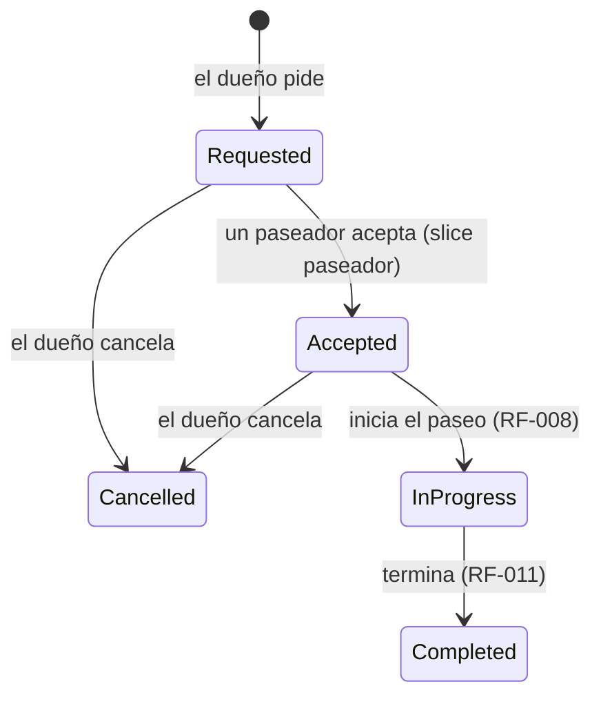
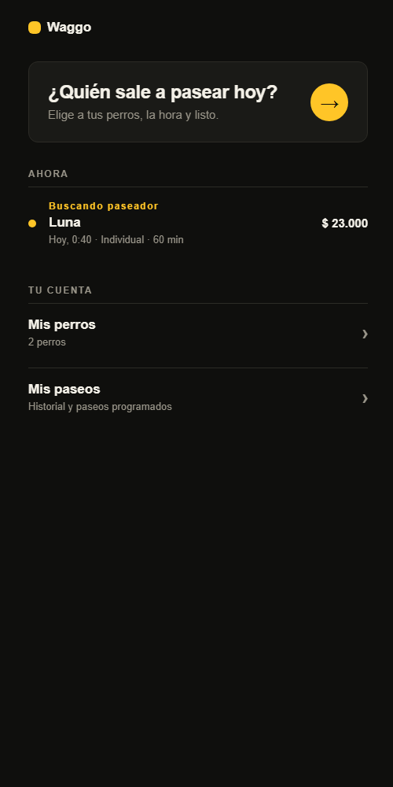
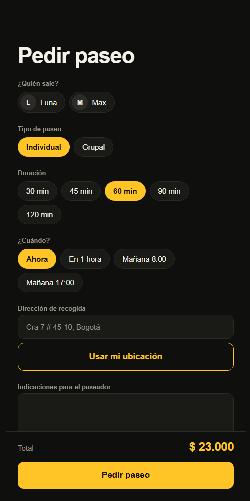
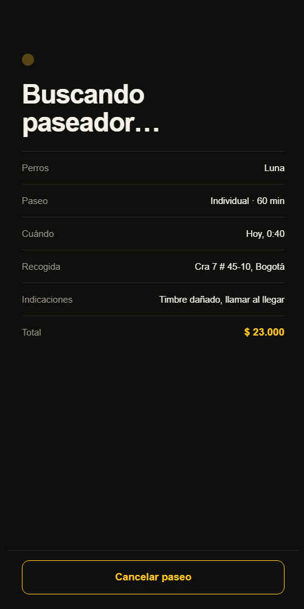
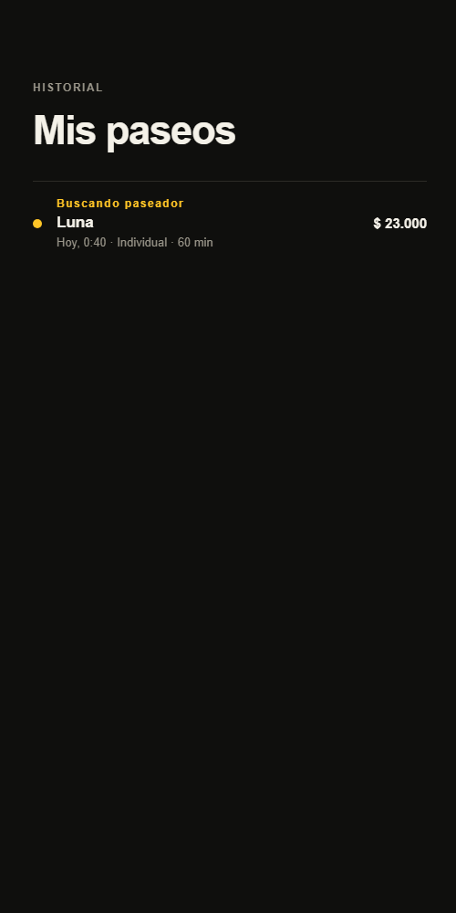

# RF-007 (slice dueño) — Pedir un paseo

> Vault: `01 Proyecto/Requerimientos funcionales.md` · `02 Arquitectura/Base de datos - PostgreSQL.md` · Roadmap: sprint 3 · Depende de RF-004 (mascotas) y RF-019 (tarifa)

Primer slice de RF-007, **inspirado en Uber**: el dueño elige a sus perros, el tipo y la duración, el punto de recogida y la hora, ve el precio y pide. La solicitud queda **buscando paseador**. El paseador la acepta en el siguiente slice (`RF-007-solicitud-de-paseo-paseador.md`).

> [!note] Decisiones asumidas por el desarrollador
> El PO no la ha validado todavía. Límites, estados y reglas de cancelación son propuestas y quedan como preguntas abiertas.

## Historia de usuario
Como **dueño** quiero **pedir un paseo para mis perros desde donde estoy, ahora o a una hora programada, viendo el precio antes de confirmar** para **resolverlo en segundos, como pedir un Uber**.

## Criterios de aceptación
- [x] El dueño pide un paseo con 1 a 3 de **sus** perros, tipo, duración, dirección y coordenadas de recogida, hora (ahora o programada) e indicaciones opcionales.
- [x] El precio se calcula con la tarifa vigente (RF-019) y **queda congelado** en el paseo.
- [x] El paseo nace en estado `Requested` (buscando paseador).
- [x] El dueño ve sus paseos (el más reciente primero) y el detalle de cada uno. Nunca ve los de otro dueño.
- [x] El dueño cancela un paseo mientras esté `Requested` o `Accepted`.

## Ciclo de vida


## Tabla de ejemplos
| # | Entrada | Resultado esperado | Tipo |
|---|---|---|---|
| 1 | `POST /walks` con Luna, `Individual`, 60 min, "Cra 7 # 45-10, Bogotá" (4.6361, -74.0645), sin hora | 200; `status: Requested`, `scheduledFor` ≈ ahora, `total: 23000`, `commission: 4600`, `walkerPayout: 18400` | Feliz |
| 2 | Igual, con Luna y Max, `Group`, 45 min, programado para mañana 8:00 | 200; `total: 11800`, `scheduledFor` = mañana 8:00 | Feliz |
| 3 | `GET /walks` tras pedir dos paseos | 200 con los dos, el más reciente primero | Feliz |
| 4 | `GET /walks` de otro dueño | 200 con lista vacía | Seguridad |
| 5 | `GET /walks/{id}` de un paseo ajeno o inexistente | 404 `Walks.NotFound` | Error |
| 6 | `POST /walks/{id}/cancel` de un paseo `Requested` | 200; `status: Cancelled` | Feliz |
| 7 | Cancelar un paseo ya cancelado | 422 `Walks.CannotCancel` | Regla de negocio |
| 8 | `POST /walks` con un perro de otro dueño | 400 `Walks.InvalidPets` | Error capa 2 |
| 9 | `POST /walks` con 4 perros | 400 `Walks.InvalidPets` | Límite |
| 10 | `POST /walks` con 50 minutos | 400 `Pricing.InvalidDuration` | Error capa 2 |
| 11 | `POST /walks` programado para dentro de 15 días o para ayer | 400 `Walks.InvalidSchedule` | Error capa 2 |
| 12 | `POST /walks` con latitud 95 | 400 `Walks.InvalidLocation` | Error capa 2 |
| 13 | `POST /walks` sin `petIds` o sin dirección | 400 `Request.Required` | Error capa 1 |
| 14 | `POST /walks` con rol `walker` | 403 `Auth.Forbidden` | Autorización |

## Reglas de negocio
| Regla | Valor | Origen |
|---|---|---|
| Perros por paseo | 1 a 3, distintos, todos del dueño | ⚠️ provisional |
| Duración | La de RF-019: 30–120 min, múltiplos de 15 | RF-019 |
| Hora | Vacía = ahora; si se programa, entre ahora y 14 días | ⚠️ provisional |
| Dirección | 5–200 caracteres | ⚠️ provisional |
| Indicaciones | Opcional, hasta 500 caracteres ("timbre dañado, llamar al llegar") | ⚠️ provisional |
| Precio | Tarifa vigente al pedir; no cambia si la tarifa cambia después | Uber |
| Cancelación | Gratis en `Requested` y `Accepted`; no se puede en `InProgress`, `Completed` ni `Cancelled` | ⚠️ provisional (¿cobro por cancelación tardía?) |

## Contrato de API
Autorización: `WaggoPolicies.Owner`.

`POST /api/v1/walks`:
```json
{ "petIds": ["…"], "walkType": "Individual", "durationMinutes": 60,
  "pickupAddress": "Cra 7 # 45-10, Bogotá", "latitude": 4.6361, "longitude": -74.0645,
  "scheduledFor": null, "notes": "Timbre dañado, llamar al llegar" }
```
`GET /api/v1/walks` · `GET /api/v1/walks/{id}` · `POST /api/v1/walks/{id}/cancel`

Respuesta (`WalkResponse`):
```json
{ "id": "…", "status": "Requested", "petIds": ["…"], "walkType": "Individual", "durationMinutes": 60,
  "pickupAddress": "Cra 7 # 45-10, Bogotá", "latitude": 4.6361, "longitude": -74.0645,
  "scheduledFor": "2026-09-30T15:00:00+00:00", "notes": "…",
  "currency": "COP", "total": 23000, "commission": 4600, "walkerPayout": 18400,
  "walkerId": null, "requestedAt": "2026-09-30T15:00:00+00:00" }
```

### Validación capa 1 — DTO (`RequestWalkRequestValidator`)
`petIds`, `walkType`, `durationMinutes`, `pickupAddress`, `latitude` y `longitude` obligatorios (`Request.Required`); `walkType` válido (`Request.InvalidValue`).

### Validación capa 2 — negocio (`RequestWalkCommandValidator`, entidad `Walk`, handler)
| Regla | `code` | HTTP |
|---|---|---|
| 1–3 perros distintos del dueño | `Walks.InvalidPets` | 400 |
| Duración válida | `Pricing.InvalidDuration` | 400 |
| Hora entre ahora y 14 días | `Walks.InvalidSchedule` | 400 |
| Coordenadas válidas | `Walks.InvalidLocation` | 400 |
| Dirección 5–200 | `Walks.InvalidAddress` | 400 |
| Indicaciones ≤ 500 | `Walks.InvalidNotes` | 400 |
| Cancelar solo en `Requested`/`Accepted` | `Walks.CannotCancel` | 422 |

### Excepciones
`NotFoundException(WalkErrors.NotFound)` → 404 cuando el paseo no existe o no es del dueño.

## Diseño
- **Domain**: `Entities/Walks/Walk` (`Request`, `Cancel`), `Enums/Walks/WalkStatus`, `ValueObjects/Walks/GeoPoint`, `Errors/Walks/WalkErrors`. Reusa `WalkType`, `WalkDuration` y `FareCalculator` de Pricing.
- **Application**: `Common/Interfaces/Walks/IWalkRepository`; `Walks/Commands/{RequestWalk, CancelWalk}`, `Walks/Queries/{ListMyWalks, GetWalk}`, `Walks/WalkResponse`.
- **Infrastructure**: `WalkConfiguration` (schema `walks`, `pet_ids uuid[]`, `pickup_location geography(Point, 4326)` con índice GiST), extensión `postgis`, NetTopologySuite; `WalkRepository`; migración `AddWalks`.
- **Api**: `Endpoints/Walks/{WalksEndpoints, Requests, Validators}`.
- **Mobile**: `features/walks` — `RequestWalkScreen` (`/paseos/nuevo`: perros, tipo, duración, cuándo — Ahora, En 1 hora, Mañana 8:00, Mañana 17:00 —, dirección + GPS con `expo-location`, indicaciones, total en vivo y "Pedir paseo"), `WalkStatusScreen` (`/paseos/[id]`: "Buscando paseador…" con un punto que pulsa, detalle, cancelar; se refresca cada 5 s mientras el paseo está activo), `MyWalksScreen` (`/paseos`).
- **Inicio del dueño** `features/home/HomeScreen` (`/inicio`), como una app de viajes: una entrada grande "¿Quién sale a pasear hoy?", el paseo en curso y accesos a mis perros y mis paseos. La bienvenida (UX-001) pasa a tener un solo botón, "Empezar", que lleva al inicio.
- La ubicación se pide solo al tocar "Usar mi ubicación" (permiso "mientras se usa la app"). Sin coordenadas no se puede pedir el paseo.

| Inicio | Pedir paseo | Buscando paseador | Mis paseos |
|---|---|---|---|
|  |  |  |  |

## Plan TDD
**Backend**: `WalksEndpointTests` (integración) → `WalkTests`, `GeoPointTests` → `RequestWalkHandlerTests`, `CancelWalkHandlerTests`, `GetWalkHandlerTests`, `ListMyWalksHandlerTests` → `RequestWalkRequestValidatorTests`.
**Mobile**: `walksApi.test.ts` → `RequestWalkScreen.test.tsx` → `WalkStatusScreen.test.tsx` → `MyWalksScreen.test.tsx`.

## Preguntas abiertas para el PO
- [ ] ¿Cuántos perros por paseo? ¿El precio cambia con el número de perros o su tamaño?
- [ ] ¿Con cuánta anticipación se puede programar?
- [ ] ¿Se cobra la cancelación tardía (después de aceptado)?
- [ ] ¿La recogida es siempre en la dirección del dueño o puede ser otra?

## Trazabilidad
| Repo | Archivos | Pruebas |
|---|---|---|
| waggo-api | `Waggo.Domain/{Entities,Enums,Errors}/Walks/*`, `Waggo.Domain/ValueObjects/Walks/GeoPoint`, `Waggo.Application/Common/Interfaces/Walks/IWalkRepository`, `Waggo.Application/Walks/{WalkResponse, Commands/{RequestWalk,CancelWalk}/*, Queries/{ListMyWalks,GetWalk}/*}`, `Waggo.Infrastructure/{Persistence/Configurations/Walks/WalkConfiguration, Persistence/Converters/GeoPointConverter, Persistence/Migrations/*_AddWalks, Services/Walks/WalkRepository}`, `Waggo.Api/Endpoints/Walks/*` | `Tests/Waggo.Api.IntegrationTests/Endpoints/Walks/WalksEndpointTests` (ejemplos 1–8, 10, 11, 13, 14), `WalkTests` y `GeoPointTests` (9, 11, 12), `Tests/Waggo.Application.UnitTests/Walks/**`, `RequestWalkRequestValidatorTests` |
| waggo-mobile | `src/features/walks/**`, `src/features/home/**`, `src/shared/location/getCurrentLocation.ts`, `src/shared/ui/BrandMark.tsx`, `src/app/{inicio, paseos/index, paseos/nuevo, paseos/[id]}.tsx`, `src/test/{mockApi, fixtures}.ts`, `app.json` (permiso de ubicación) | `walksApi.test.ts`, `whenOptions.test.ts`, `describeWalk.test.ts`, `RequestWalkScreen.test.tsx`, `WalkStatusScreen.test.tsx`, `MyWalksScreen.test.tsx`, `HomeScreen.test.tsx`, `getCurrentLocation.test.ts`, `WelcomeScreen.test.tsx` |
