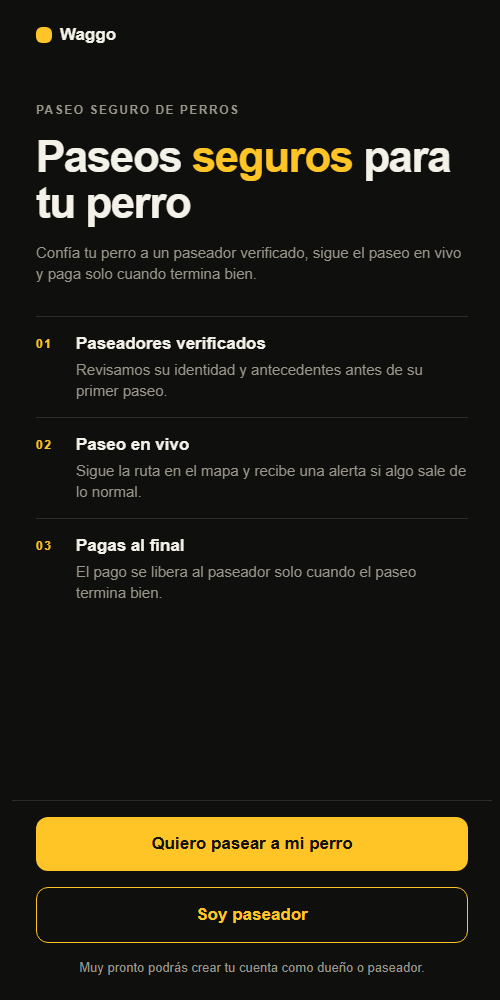
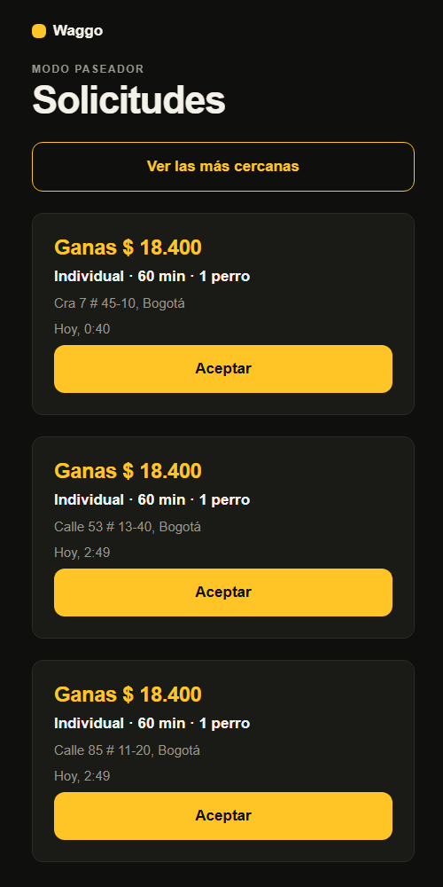
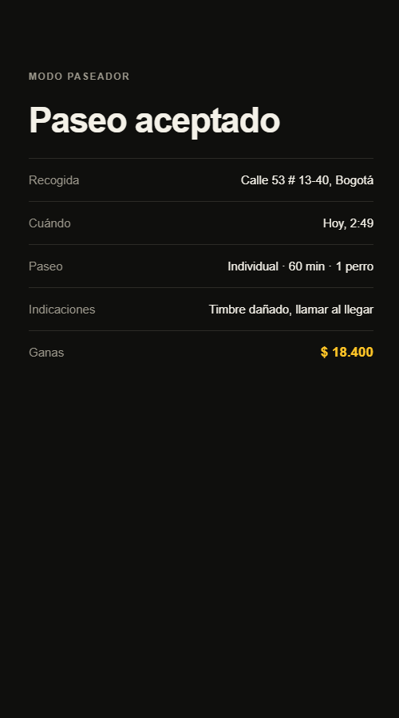
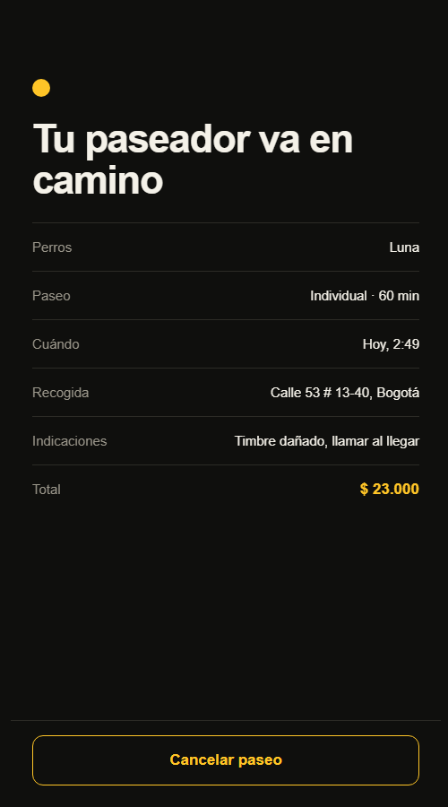

# RF-007 (slice paseador) — Ver solicitudes y aceptar

> Vault: `01 Proyecto/Requerimientos funcionales.md` · Roadmap: sprint 3 · Depende de `RF-007-solicitud-de-paseo-dueno.md`

Cierra RF-007 ("el paseador acepta o rechaza"). Como un conductor de Uber, el paseador ve las solicitudes abiertas, las más cercanas primero, con lo que va a ganar, y **la primera persona que acepta se queda con el paseo**. "Rechazar" es simplemente no aceptarla: la solicitud sigue disponible para otros paseadores.

> [!note] Decisiones asumidas por el desarrollador
> - El orden por cercanía usa la distancia en línea recta (haversine) calculada en el dominio. El matching real con PostGIS y paseadores verificados es RF-006 (sprint 4).
> - Mientras no exista el registro de paseadores (RF-002/RF-003), cualquier usuario con rol `walker` puede aceptar. No hay verificación todavía.
> - Mientras no exista el login (ADR-011), la app en **desarrollo** elige su identidad (dueño o paseador) con los headers `X-Dev-User-Id` y `X-Dev-Roles`, que la API solo acepta con el usuario de desarrollo activo.

## Historia de usuario
Como **paseador** quiero **ver los paseos pedidos cerca de mí y lo que voy a ganar, y aceptar uno con un toque** para **llenar mi día de trabajo sin intermediarios**.

## Criterios de aceptación
- [x] El paseador ve las solicitudes en estado `Requested` que no son suyas como dueño, con tipo, duración, número de perros, zona, hora y **lo que gana** (`walkerPayout`).
- [x] Si envía su ubicación, las ve ordenadas de la más cercana a la más lejana, con la distancia; si no, por hora del paseo.
- [x] Al aceptar, el paseo pasa a `Accepted` con su `walkerId`, y el dueño lo ve en su pantalla ("Tu paseador va en camino").
- [x] Si otro paseador ya la aceptó, recibe un error claro (409). Dos aceptaciones simultáneas no pueden ganar ambas.
- [x] Un usuario no puede aceptar su propio paseo.
- [x] El paseador ve los paseos que aceptó y su detalle (dirección exacta e indicaciones).

## Tabla de ejemplos
| # | Entrada | Resultado esperado | Tipo |
|---|---|---|---|
| 1 | Dueño A pide un paseo; paseador B consulta `GET /walks/available` | La solicitud aparece con `walkerPayout: 18400`, `petCount: 1`, sin `distanceKm` | Feliz |
| 2 | B consulta con `latitude/longitude` y hay dos solicitudes a 1 km y 5 km | La de 1 km primero; `distanceKm` ≈ 1 y ≈ 5 | Feliz |
| 3 | B consulta y A tiene un paseo cancelado | El cancelado no aparece | Límite |
| 4 | A consulta `available` con rol walker | Su propio paseo no aparece | Límite |
| 5 | B `POST /walks/{id}/accept` | 200; `status: Accepted`, `walkerId: B` | Feliz |
| 6 | A consulta `GET /walks/{id}` después | Ve `status: Accepted` y el `walkerId` | Feliz |
| 7 | C acepta el mismo paseo después de B | 409 `Walks.NotAvailable` | Conflicto |
| 8 | A acepta su propio paseo (con rol walker) | 422 `Walks.OwnWalk` | Regla de negocio |
| 9 | B acepta un paseo inexistente | 404 `Walks.NotFound` | Error |
| 10 | B consulta `GET /walks/assigned` | Lista con el paseo aceptado | Feliz |
| 11 | B consulta `GET /walks/{id}` del paseo aceptado | 200 con el detalle | Feliz |
| 12 | C consulta `GET /walks/{id}` del paseo de A aceptado por B | 404 `Walks.NotFound` | Seguridad |
| 13 | Dueño (rol `owner` solo) consulta `available` | 403 `Auth.Forbidden` | Autorización |
| 14 | El dueño cancela un paseo `Accepted` | 200 `Cancelled` (ya cubierto en el slice dueño) | Feliz |

## Reglas de negocio
| Regla | Valor | Origen |
|---|---|---|
| Quién ve una solicitud | Cualquier `walker` que no sea el dueño | ⚠️ provisional (con RF-006: solo verificados y cercanos) |
| Orden | Distancia en línea recta si hay ubicación; si no, hora del paseo | ⚠️ provisional |
| Quién gana | El primero que acepta; concurrencia optimista (`xmin`) | Uber |
| Aceptar el propio paseo | No permitido | Sentido común |
| Qué ve el paseador antes de aceptar | Zona (dirección), hora, tipo, duración, número de perros y ganancia. No ve indicaciones ni notas médicas | ⚠️ provisional |

## Contrato de API
`GET /api/v1/walks/available?latitude=4.65&longitude=-74.05` — `WaggoPolicies.Walker`. Respuesta: lista de `AvailableWalkResponse`:
```json
{ "id": "…", "walkType": "Individual", "durationMinutes": 60, "petCount": 1,
  "pickupAddress": "Cra 7 # 45-10, Bogotá", "latitude": 4.6361, "longitude": -74.0645,
  "scheduledFor": "…", "currency": "COP", "walkerPayout": 18400, "distanceKm": 1.2 }
```
`POST /api/v1/walks/{id}/accept` — `WaggoPolicies.Walker`. Respuesta: `WalkResponse`.
`GET /api/v1/walks/assigned` — `WaggoPolicies.Walker`. Respuesta: lista de `WalkResponse`.
`GET /api/v1/walks/{id}` — ahora también para el paseador asignado (usuario autenticado; el handler verifica que sea el dueño o el paseador).

| Regla | `code` | HTTP |
|---|---|---|
| El paseo ya no está `Requested` | `Walks.NotAvailable` | 409 |
| El paseador es el dueño | `Walks.OwnWalk` | 422 |
| Coordenadas de consulta inválidas | `Walks.InvalidLocation` | 400 |

## Diseño
- **Domain**: `Walk.Accept(walkerId, now)` (`AcceptedAt`), `GeoPoint.DistanceKmTo(other)` (haversine), errores `NotAvailable` (Conflict) y `OwnWalk` (BusinessRule).
- **Application**: `Walks/Commands/AcceptWalk`, `Walks/Queries/{ListAvailableWalks, ListAssignedWalks}`, `Walks/AvailableWalkResponse`; `GetWalk` admite al paseador asignado. `IWalkRepository` suma `ListRequestedAsync` y `ListByWalkerAsync`.
- **Infrastructure**: token de concurrencia `xmin` en `walks` (migración `AddWalkConcurrency`); `WalkRepository.SaveChangesAsync` traduce `DbUpdateConcurrencyException` a `ConflictException(Walks.NotAvailable)`.
- **Mobile**: la bienvenida ofrece "Quiero pasear a mi perro" y "Soy paseador". `shared/api/devIdentity` + `_layout` fijan la identidad de desarrollo según la ruta (`/paseador` → `dev-walker`, el resto → `dev-owner`). `features/walker`: `WalkerHomeScreen` (`/paseador`: tarjetas "Ganas $ …" con "Aceptar", orden por cercanía al compartir la ubicación, refresco cada 10 s, y "Tus paseos") y `AssignedWalkScreen` (`/paseador/[id]`: recogida exacta, indicaciones y ganancia; avisa si el dueño canceló). Se acepta desde la tarjeta, como un conductor; no hay pantalla de detalle previa porque antes de aceptar el paseador no puede leer el paseo completo.
- Concurrencia demostrada con `WalkConcurrencyTests`: dos paseadores cargan el mismo paseo, aceptan y solo el primero guarda.

| Entrada por rol | Solicitudes | Paseo aceptado (paseador) | Vista del dueño |
|---|---|---|---|
|  |  |  |  |

## Plan TDD
**Backend**: `WalkerEndpointTests` (integración) → `WalkTests` (Accept), `GeoPointTests` (distancia) → `AcceptWalkHandlerTests`, `ListAvailableWalksHandlerTests`, `ListAssignedWalksHandlerTests`, `GetWalkHandlerTests` (paseador) → validador de la consulta.
**Mobile**: `devIdentity.test.ts`, `httpClient` (headers), `walkerApi.test.ts`, `describeOffer.test.ts`, `WalkerHomeScreen.test.tsx`, `AssignedWalkScreen.test.tsx`, `WelcomeScreen.test.tsx`.

## Preguntas abiertas para el PO
- [ ] ¿Qué ve el paseador antes de aceptar? (¿dirección exacta o solo el barrio?, ¿nombres y tamaños de los perros?)
- [ ] ¿Radio máximo para mostrar solicitudes?
- [ ] ¿El paseador puede soltar un paseo ya aceptado? ¿Con penalización?
- [ ] ¿Qué pasa si nadie acepta en X minutos? (¿se cancela sola?, ¿se avisa al dueño?)

> [!note] Cambio posterior (propuesta de diseño, 2026-10-27; rompe ADR-019 en el lado del paseador)
> Por orden del PO, implementado según `design/propuesta/07` · pantallas 28–33. **Sin cambios de API.**
> - **Cuatro pestañas** para el paseador (`(walker-tabs)`): Inicio (`/paseador`, solicitudes), Paseos (`/paseador/paseos`, `WalkerWalksScreen`: En curso, Próximos, Historial sobre `GET /walks/assigned`), Ganancias (`/paseador/ganancias`, `EarningsScreen` sobre `GET /payments/earnings`, RF-017) y Configuración. ADR-019 decía dos (Inicio y Configuración): **hay que actualizar el ADR en el vault** (no se tocó en esta corrida).
> - **Inicio**: la lista de "Tus paseos" y la tarjeta de ganancias salen de Inicio (van a sus pestañas); arriba queda el paseo en curso o aceptado. Sin ubicación, aviso "Comparte tu ubicación" con "Ver las más cercanas"; con permiso negado, aviso para reintentar. Vacío: "No hay solicitudes cerca por ahora". Si otro paseador la tomó (409), además del mensaje de la API la tarjeta queda atenuada como "Ya no disponible".
> - **Paseo asignado**: "Abrir en Maps" (enlace universal de Google Maps con las coordenadas de la recogida, sin costo para Waggo), "Terminar paseo" pide confirmación y al terminar muestra "¡Paseo terminado!" + "Ganaste $ X" y "Ver más solicitudes".
> - **Verificación** (`WalkerGate`): línea de tiempo de tres pasos (Datos enviados · Revisamos tu documento · Listo para pasear).
> - **Pendiente**: mapa con píldoras de precio (proveedor sin decidir), estado "Disponible" y ETA (`nueva — requiere spec`), mostrar zona en vez de dirección antes de aceptar (pregunta abierta), "Escribir a soporte" (canal sin spec).

> [!note] Cambio posterior (decisión del PO: mapas con OpenStreetMap, 2026-10-27)
> Cierra el pendiente del mapa. **Sin cambios de API.** Borrador de ADR: [`_adr-borrador-mapas-openstreetmap.md`](_adr-borrador-mapas-openstreetmap.md).
> - **Inicio del paseador**: arriba de la lista, mapa de OpenStreetMap con una **píldora de precio** por solicitud ("$ 18.400") dibujada en el **centro de la cuadra** (coordenadas redondeadas a 3 decimales, ~110 m), no en la casa, y la posición del paseador cuando la comparte. Tocar una píldora la resalta y sube su tarjeta al primer lugar. Resumen para lectores de pantalla ("Mapa con 2 solicitudes…") y "Ver como lista". Los avisos de ubicación no cambian.
> - **Paseo aceptado**: mapa con la recogida; "Ver mi distancia a la recogida" pide la ubicación y dibuja un tramo **punteado en línea recta** hasta la recogida ("estás a 450 m en línea recta"). No hay ruta por calles ni ETA (necesitarían un servicio de rutas: `nueva — requiere spec`). "Abrir en Maps" (Google Maps por enlace) se conserva.
> - **Paseo en curso**: mapa con el recorrido, la zona acordada y la recogida (`WalkMap`, RF-008) y el aviso fijo "Mantén Waggo abierta durante el paseo: si bloqueas el teléfono o cambias de app, dejamos de compartir tu ruta con el dueño." (no hay rastreo en segundo plano; el permiso "Siempre" del diseño queda como pregunta para el PO).
> - **Sigue pendiente**: grupos de píldoras cercanas, estado "Disponible", ETA, zona en vez de dirección en la tarjeta antes de aceptar.

> [!note] Cambio posterior (propuesta de diseño 07 · 28–30, hoja de terminar, 2026-10-27)
> **Sin cambios de API.**
> - **Terminar paseo** (`AssignedWalkScreen`): bajo el botón, "Tócalo al entregar a los perros en la recogida."; la confirmación es una **hoja inferior** (`shared/ui/BottomSheet`): "¿Terminar el paseo?" · "Confirma que entregaste a los perros en [dirección]. Al terminar se cobra el pago y recibes $ X." · "Sí, terminar paseo" / "Seguir paseando". Se cierra con atrás, Escape o el fondo, salvo mientras termina. Si la API falla, la hoja sigue abierta con el `message` de cada error. El aviso "Estás a 1,1 km de la recogida" del diseño sigue `nueva — requiere spec`.
> - **"Abrir en Maps"**: si el teléfono no puede abrir el enlace, "No pudimos abrir Maps. Busca la dirección de la recogida en tu app de mapas."
> - **Emergencia**: la hoja de RF-012 ofrece "Escribir al dueño" (chat) tras enviar.
> - **Solicitudes** (`WalkerHomeScreen`, revisión): si la primera carga falla solo se ve "No pudimos cargar las solicitudes." + "Intentar de nuevo" (sin mapa vacío); si falla un refresco, se conserva la lista con "No pudimos actualizar las solicitudes. Mostramos lo último que recibimos.".

## Trazabilidad
| Repo | Archivos | Pruebas |
|---|---|---|
| waggo-api | `Walk.Accept`, `GeoPoint.DistanceKmTo`, `WalkErrors.{NotAvailable, OwnWalk}`; `Waggo.Application/Walks/{AvailableWalkResponse, Commands/AcceptWalk/*, Queries/{ListAvailableWalks, ListAssignedWalks}/*}`, `GetWalkHandler` (paseador asignado); `WalkRepository` (`ListRequestedAsync`, `ListByWalkerAsync`, conflicto de concurrencia), `WalkConfiguration` (`xmin`), migración `AddWalkConcurrency`; `WalksEndpoints` (grupo walker) | `WalkerEndpointTests` (ejemplos 1–13), `WalkConcurrencyTests`, `WalkTests`, `GeoPointTests`, `AcceptWalkHandlerTests`, `ListAvailableWalksHandlerTests`, `ListAssignedWalksHandlerTests`, `GetWalkHandlerTests` |
| waggo-mobile | `src/features/walker/**`, `src/shared/api/{devIdentity, httpClient}.ts`, `src/shared/ui/DetailRow.tsx`, `src/app/{_layout, index, paseador/index, paseador/[id]}.tsx`, `WelcomeScreen` | `walkerApi.test.ts`, `describeOffer.test.ts`, `WalkerHomeScreen.test.tsx`, `AssignedWalkScreen.test.tsx`, `devIdentity.test.ts`, `httpClient.test.ts`, `WelcomeScreen.test.tsx` |
