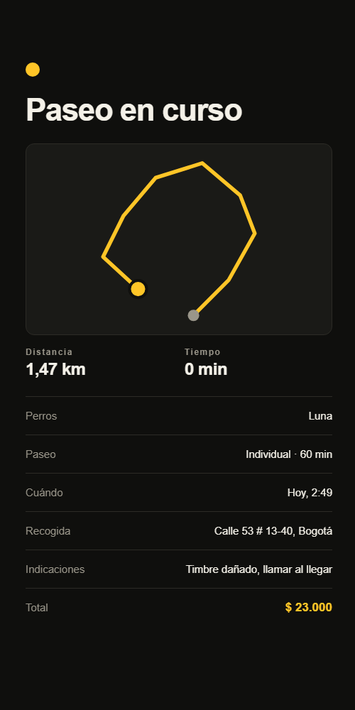
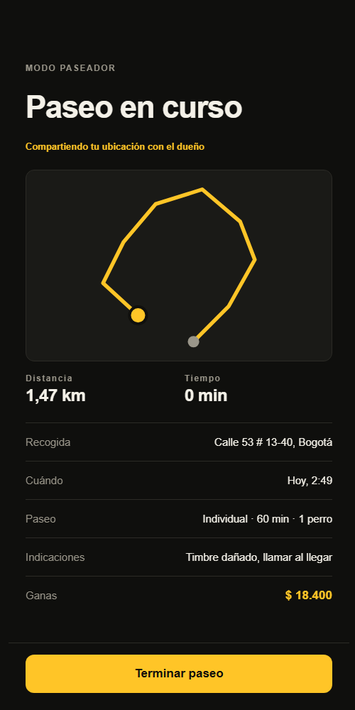

# RF-008 + RF-011 — Paseo en vivo

> Vault: `01 Proyecto/Requerimientos funcionales.md` (RF-008 GPS en tiempo real, RF-011 métricas del paseo) · `Requerimientos no funcionales.md` (RNF-007) · Roadmap: sprint 5, adelantado · Depende de RF-007

Como seguir el auto en Uber: el paseador **inicia** el paseo al recoger a los perros, su teléfono **envía la posición** mientras camina y lo **termina** al devolverlos. El dueño ve la **ruta en vivo**, y al final queda el **resumen** con la distancia y la duración (RF-011).

> [!note] Decisiones asumidas por el desarrollador
> - **Transporte**: en este slice la app del dueño consulta la ruta por HTTP cada 5 s, igual que "buscando paseador". SignalR (RNF-007) llega en un slice propio, sin cambiar el modelo ni la API de ingesta.
> - **Ingesta por lotes** (RNF-007): el paseador envía varias posiciones en un solo request (`POST /track`), ya pensado para cuando no hay señal.
> - **Mapa**: la ruta se dibuja con SVG (sin proveedor de mapas), igual en iOS, Android y web. El mapa base (Mapbox o Google) queda para cuando se elija proveedor.

## Historias de usuario
- Como **paseador** quiero **iniciar el paseo al recoger a los perros y terminarlo al devolverlos** para **que el dueño sepa en qué va y el paseo quede registrado**.
- Como **dueño** quiero **ver en vivo por dónde va mi perro y, al final, cuánto caminó y cuánto duró** para **estar tranquilo**.

## Criterios de aceptación
- [x] Solo el paseador asignado inicia (`Accepted → InProgress`) y termina (`InProgress → Completed`) el paseo.
- [x] Mientras está `InProgress`, el paseador envía lotes de posiciones; fuera de ese estado se rechazan.
- [x] El dueño y el paseador ven la ruta (puntos en orden) con la distancia recorrida y los minutos transcurridos.
- [x] Al terminar queda el resumen (RF-011): distancia total y duración real.
- [x] Nadie más ve la ruta.

## Tabla de ejemplos
| # | Entrada | Resultado esperado | Tipo |
|---|---|---|---|
| 1 | El paseador asignado `POST /walks/{id}/start` sobre un paseo `Accepted` | 200; `status: InProgress`, `startedAt` | Feliz |
| 2 | Otro paseador intenta iniciarlo | 404 `Walks.NotFound` | Seguridad |
| 3 | Iniciar un paseo `Requested` o ya iniciado | 422 `Walks.CannotStart` | Regla |
| 4 | `POST /walks/{id}/track` con 3 posiciones mientras está `InProgress` | 200; la ruta tiene 3 puntos en orden de `recordedAt` | Feliz |
| 5 | Enviar posiciones a un paseo `Accepted` o `Completed` | 422 `Tracking.WalkNotInProgress` | Regla |
| 6 | Un lote vacío o con más de 100 posiciones | 400 `Tracking.InvalidBatch` | Límite |
| 7 | Una posición con latitud 95 | 400 `Walks.InvalidLocation` | Error |
| 8 | El dueño `GET /walks/{id}/track` | 200; puntos, `distanceKm` (suma de tramos) y `elapsedMinutes` | Feliz |
| 9 | Otro dueño consulta la ruta | 404 `Walks.NotFound` | Seguridad |
| 10 | El paseador `POST /walks/{id}/finish` | 200; `status: Completed`, `finishedAt`; la ruta queda con su resumen | Feliz |
| 11 | Terminar un paseo que no está en curso | 422 `Walks.CannotFinish` | Regla |
| 12 | El dueño intenta cancelar un paseo `InProgress` | 422 `Walks.CannotCancel` (ya existente) | Regla |

## Reglas de negocio
| Regla | Valor | Origen |
|---|---|---|
| Quién inicia y termina | Solo el paseador asignado | RF-008 |
| Tamaño del lote | 1–100 posiciones | ⚠️ provisional (RNF-007) |
| Frecuencia de envío | Cada ~15 s desde la app | ⚠️ provisional |
| Distancia | Suma de tramos en línea recta (haversine) entre puntos ordenados | RF-011 |
| Duración | De `startedAt` a `finishedAt` (o a ahora si sigue en curso) | RF-011 |

## Contrato de API
- `POST /api/v1/walks/{id}/start` · `POST /api/v1/walks/{id}/finish` — `WaggoPolicies.Walker`; responden `WalkResponse` (ahora con `startedAt` y `finishedAt`).
- `POST /api/v1/walks/{id}/track` — `WaggoPolicies.Walker`: `{ "points": [{ "latitude": 4.6361, "longitude": -74.0645, "recordedAt": "…" }] }`.
- `GET /api/v1/walks/{id}/track` — dueño o paseador asignado: `{ "points": [{ "latitude", "longitude", "recordedAt" }], "distanceKm": 1.2, "elapsedMinutes": 18 }`.

## Diseño
- **Domain**: `Walk.Start`, `Walk.Finish` (`StartedAt`, `FinishedAt`); `Entities/Tracking/TrackPoint` (`WalkId`, `GeoPoint`, `RecordedAt`); `Services/Tracking/RouteMetrics` (distancia y duración); `Errors/Tracking/TrackingErrors`.
- **Application**: `Walks/Commands/{StartWalk, FinishWalk}`, `Tracking/Commands/RecordTrack`, `Tracking/Queries/GetRoute`; `ITrackPointRepository`.
- **Infrastructure**: tabla `tracking.track_points` (`location geography(Point, 4326)` con GiST, índice BRIN en `recorded_at` según la nota *Base de datos*), migración `AddTracking`.
- **Mobile**: paseador — "Iniciar paseo", `useTrackingBeacon` guarda la posición cada 15 s y la envía por lotes (si falla, la conserva y la reenvía con el siguiente lote), "Terminar paseo". Dueño — `WalkRoute`/`RouteView` (SVG con `react-native-svg`: ruta amarilla, inicio gris, posición actual amarilla) con distancia y tiempo; se refresca cada 5 s mientras está en curso y queda como resumen al terminar.

| Dueño: paseo en curso | Paseador: compartiendo ubicación |
|---|---|
|  |  |

## Plan TDD
**Backend**: `TrackingEndpointTests` → `WalkTests` (Start/Finish), `TrackPointTests`, `RouteMetricsTests` → handlers.
**Mobile**: `trackingApi.test.ts`, `routeGeometry.test.ts` (proyección de puntos al SVG), `RouteView.test.tsx`, `AssignedWalkScreen.test.tsx` (iniciar, enviar, terminar), `WalkStatusScreen.test.tsx` (ruta y métricas).

## Preguntas abiertas para el PO
- [ ] ¿Proveedor de mapas (Mapbox, Google)?
- [ ] ¿Cada cuánto enviar la posición? (batería vs. precisión)
- [ ] ¿El dueño ve la ruta del paseo después de terminado? ¿Por cuánto tiempo se guarda (privacidad)?

## Trazabilidad
| Repo | Archivos | Pruebas |
|---|---|---|
| waggo-api | `Walk.{Start,Finish}`, `Entities/Tracking/TrackPoint`, `Services/Tracking/RouteMetrics`, `Errors/Tracking/TrackingErrors`; `Walks/Commands/{StartWalk,FinishWalk}`, `Tracking/Commands/RecordTrack`, `Tracking/Queries/GetRoute`, `ITrackPointRepository`; `TrackPointConfiguration` (GiST + BRIN), `TrackPointRepository`, migración `AddTracking`; `Endpoints/Tracking/*`, start/finish en `WalksEndpoints` | `TrackingEndpointTests` (ejemplos 1–11), `WalkTests` (Start/Finish/Cancel en curso), `RouteMetricsTests`, `StartAndFinishWalkHandlerTests`, `TrackingHandlersTests` |
| waggo-mobile | `src/features/tracking/**`, `src/features/walker/{api,hooks}/*` (start/finish), `AssignedWalkScreen`, `WalkStatusScreen`, `Walk` con `startedAt`/`finishedAt`, dependencia `react-native-svg` | `routeGeometry.test.ts`, `trackingApi.test.ts`, `RouteView.test.tsx`, `AssignedWalkScreen.test.tsx`, `WalkStatusScreen.test.tsx` |
