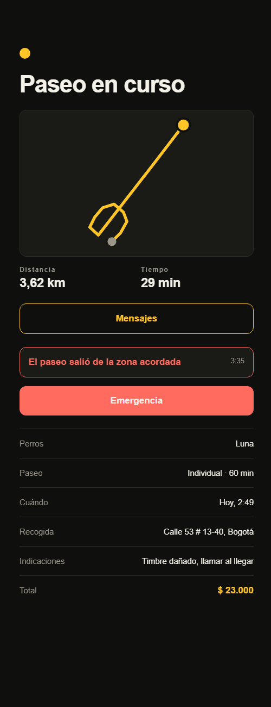

# RF-009 + RF-010 — Alertas automáticas

> Vault: `01 Proyecto/Requerimientos funcionales.md` (RF-009 geocercas, RF-010 anomalías) · Roadmap: sprint 6, adelantado · Depende de RF-008 y RF-012

La plataforma vigila el paseo sola mientras recibe la ruta (RF-008). Si el paseo **sale de la zona acordada** (geocerca) o el paseador **lleva un rato detenido** (anomalía), crea una alerta que el dueño y el paseador ven en el mismo aviso de las emergencias (RF-012).

> [!note] Decisiones asumidas por el desarrollador
> - **Geocerca**: un círculo de 1,5 km alrededor del punto de recogida. La alerta se crea al **cruzar el borde hacia afuera**; si el paseo sigue afuera no se repite, y si vuelve a entrar y salir se crea otra.
> - **Detención**: 10 minutos sin alejarse más de 30 m. Una alerta por cada detención; si retoma el paseo y vuelve a detenerse, hay otra.
> - Las alertas automáticas no tienen `raisedBy` (las crea el sistema).
> - La evaluación ocurre en el servidor al recibir cada lote de posiciones, así funciona igual con la app en segundo plano.

## Criterios de aceptación
- [x] Al recibir posiciones fuera del radio, habiendo estado dentro, se crea una alerta `Geofence` con la posición donde salió.
- [x] Si las posiciones de los últimos 10 minutos están todas a menos de 30 m de la última, se crea una alerta `Anomaly`, una sola vez por detención.
- [x] Las alertas automáticas aparecen en `GET /walks/{id}/alerts` con `raisedBy: null` y en el aviso de la app con un texto propio.

## Tabla de ejemplos
| # | Entrada | Resultado esperado | Tipo |
|---|---|---|---|
| 1 | Lote con un punto a 3 km de la recogida (antes estaba cerca) | 1 alerta `Geofence` en ese punto | Feliz |
| 2 | Otro lote todavía afuera | Ninguna alerta nueva | Límite |
| 3 | Vuelve a entrar y sale otra vez | Una segunda alerta `Geofence` | Feliz |
| 4 | Puntos durante 11 min a menos de 30 m entre sí | 1 alerta `Anomaly` | Feliz |
| 5 | Sigue quieto en el siguiente lote | Ninguna alerta nueva | Límite |
| 6 | Puntos durante 8 min quieto | Ninguna alerta (no alcanza los 10 min) | Límite |
| 7 | Paseo normal: se mueve y no sale del radio | Ninguna alerta | Feliz |

## Reglas de negocio
| Regla | Valor | Origen |
|---|---|---|
| Radio de la geocerca | 1,5 km desde la recogida | ⚠️ provisional |
| Detención | 10 min dentro de 30 m | ⚠️ provisional (pregunta abierta del roadmap) |

## Diseño
- **Domain**: `AlertKind` suma `Geofence` y `Anomaly`; `WalkAlert.Raise(kind, location, at)` para alertas del sistema (`RaisedBy` opcional); `Services/Tracking/WalkMonitor.Check(...)` devuelve las alertas a crear a partir de la recogida, la ruta previa, el lote nuevo y la última anomalía.
- **Application**: `RecordTrackHandler` llama a `WalkMonitor` y guarda las alertas.
- **Infrastructure**: `raised_by` pasa a admitir nulos (migración `AllowSystemAlerts`).
- **Mobile**: `AlertBanner` muestra "El paseo salió de la zona acordada" y "El paseo lleva 10 minutos detenido"; `raisedBy` pasa a admitir `null`.

Probado de punta a punta: dos posiciones hacia el norte (3,6 km de ruta) → alerta `Geofence` sin `raisedBy`, visible para el dueño.

## Preguntas abiertas para el PO
- [ ] ¿La zona la define el dueño (dibujándola) o es un radio fijo?
- [ ] ¿Umbral real de detención? (un perro puede detenerse a jugar)
- [ ] ¿Quién más recibe estas alertas? (soporte)

## Trazabilidad
| Repo | Archivos | Pruebas |
|---|---|---|
| waggo-api | `Services/Tracking/WalkMonitor`, `AlertKind.{Geofence,Anomaly}`, `WalkAlert.RaiseAutomatic` (`RaisedBy` opcional), `RecordTrackHandler` (evalúa cada lote), `WalkAlertConfiguration`, migración `AllowSystemAlerts` | `WalkMonitorTests` (ejemplos 1–7), `TrackingHandlersTests`, `AutomaticAlertEndpointTests` |
| waggo-mobile | `src/features/tracking/{model/alerts, api/alertsApi}` | `AlertBanner.test.tsx` |
