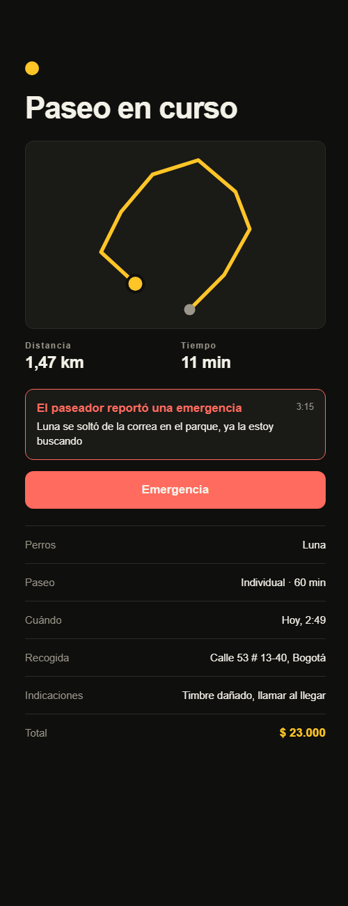
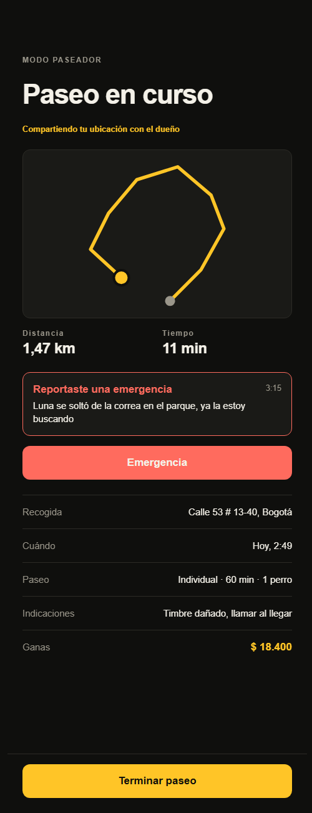

# RF-012 — Alerta de emergencia

> Vault: `01 Proyecto/Requerimientos funcionales.md` (RF-012) · Roadmap: sprint 6, adelantado · Depende de RF-008

El pilar de Waggo es el **paseo seguro**. Durante un paseo, el paseador o el dueño pueden levantar una **emergencia** con un toque: queda registrada con quién la levantó, el mensaje y la ubicación, y los dos la ven de inmediato en la pantalla del paseo.

> [!note] Decisiones asumidas por el desarrollador
> - La **notificación push prioritaria** necesita `expo-notifications`, credenciales de APNs/FCM y un dispositivo físico, así que queda para RF-014. En este slice el aviso aparece en la pantalla del paseo, que ya se refresca cada 5 s.
> - El modelo `WalkAlert` tiene un `Kind` para que geocercas (RF-009) y anomalías (RF-010) usen la misma tabla.
> - Para evitar toques accidentales, el botón pide confirmación ("Sí, es una emergencia").

## Historia de usuario
Como **paseador o dueño** quiero **avisar una emergencia con un toque durante el paseo** para **que la otra persona (y luego la plataforma) reaccione de inmediato**.

## Criterios de aceptación
- [x] Durante un paseo `Accepted` o `InProgress`, el dueño o el paseador asignado levantan una emergencia con mensaje y ubicación opcionales.
- [x] Queda registrado quién la levantó (dueño o paseador) y cuándo.
- [x] Ambos ven las alertas del paseo, la más reciente primero. Nadie más las ve.
- [x] No se puede levantar en un paseo pedido, terminado o cancelado.

## Tabla de ejemplos
| # | Entrada | Resultado esperado | Tipo |
|---|---|---|---|
| 1 | El paseador `POST /walks/{id}/emergency` con `{ message: "Luna se soltó", latitude, longitude }` en un paseo `InProgress` | 200; alerta `Emergency`, `raisedBy: Walker`, con mensaje y ubicación | Feliz |
| 2 | El dueño la levanta sin mensaje ni ubicación en un paseo `Accepted` | 200; `raisedBy: Owner` | Feliz |
| 3 | El dueño consulta `GET /walks/{id}/alerts` | Ve las dos alertas, la más reciente primero | Feliz |
| 4 | Otro usuario consulta o levanta una alerta | 404 `Walks.NotFound` | Seguridad |
| 5 | Levantarla en un paseo `Requested`, `Completed` o `Cancelled` | 422 `Alerts.WalkNotActive` | Regla |
| 6 | Mensaje de más de 500 caracteres | 400 `Alerts.InvalidMessage` | Límite |
| 7 | Latitud 95 | 400 `Walks.InvalidLocation` | Error |

## Contrato de API
- `POST /api/v1/walks/{id}/emergency` — dueño o paseador asignado (usuario autenticado): `{ "message": "…", "latitude": 4.6, "longitude": -74.0 }` (todo opcional). Respuesta: `WalkAlertResponse`.
- `GET /api/v1/walks/{id}/alerts` — dueño o paseador asignado. Respuesta: lista de `WalkAlertResponse`:
```json
{ "id": "…", "kind": "Emergency", "raisedBy": "Walker", "message": "Luna se soltó",
  "latitude": 4.6361, "longitude": -74.0645, "raisedAt": "…" }
```

## Diseño
- **Domain**: `Entities/Tracking/WalkAlert` (`RaiseEmergency`), `Enums/Tracking/{AlertKind, AlertParty}`, errores `Alerts.*`.
- **Application**: `Tracking/Commands/RaiseEmergency`, `Tracking/Queries/ListWalkAlerts`, `IWalkAlertRepository`, `WalkAlertResponse`.
- **Infrastructure**: `tracking.walk_alerts`, migración `AddWalkAlerts`.
- **Mobile**: `features/tracking` — `WalkSafety` (aviso + botón) con `EmergencyButton` (rojo, con confirmación "Sí, es una emergencia" / "No, volver"), `AlertBanner` ("El paseador reportó…", "El dueño reportó…" o "Reportaste…", con hora y mensaje) y `useWalkAlerts`/`useRaiseEmergency` (envía la ubicación si el teléfono la tiene, sin esperar un GPS que no responde). Aparece en la pantalla del dueño y en la del paseador mientras el paseo está aceptado o en curso. `Button` suma la variante `danger`; el rojo queda reservado para errores y emergencias (ADR-013).

| Dueño | Paseador |
|---|---|
|  |  |

## Plan TDD
**Backend**: `AlertEndpointTests` → `WalkAlertTests` → handlers.
**Mobile**: `alertsApi.test.ts`, `EmergencyButton.test.tsx`, `AlertBanner.test.tsx`, pantallas.

## Preguntas abiertas para el PO
- [ ] ¿Quién más recibe la alerta? (soporte de la plataforma, contacto de emergencia del dueño, servicios de emergencia)
- [ ] ¿La alerta debe llamar automáticamente a alguien?
- [ ] ¿Se necesita "resolver" la alerta?

> [!note] Cambio posterior (propuesta de diseño, 2026-10-27)
> La confirmación (`EmergencyButton`) muestra "¿Es una emergencia?", qué va a pasar, un tipo opcional (Se soltó / Se lastimó / Otro) y un mensaje opcional (≤ 500); ambos viajan en el campo `message` ya existente (sin cambio de API; sin elegir nada, el cuerpo es igual que antes). Enviada: aviso rojo "Emergencia enviada · Mantén la calma; el paseo quedó marcado." Si falla: "No pudimos enviar la alerta. Intenta de nuevo." con "Reintentar". "Llamar al 123" no se implementó (⚠️ decisión del PO).

> [!note] Cambio posterior (propuesta de diseño 07 · 21, hoja de emergencia, 2026-10-27; reemplaza la nota anterior en la confirmación y el error)
> **Sin cambios de API**: el cuerpo de `POST /walks/{id}/emergency` es el mismo.
> - La confirmación es ahora una **hoja inferior** (`shared/ui/BottomSheet`, sobre `Modal` con `scrim`) en lugar de una tarjeta dentro de la pantalla: "¿Es una emergencia?", "Avisaremos de inmediato al paseador / al dueño con tu ubicación actual." (sin nombre: el contrato no lo trae), "¿Qué pasa?" (Se soltó / Se lastimó / Otro), "Mensaje (opcional)" (≤ 500), "Sí, es una emergencia" (`danger`) y "No, volver". Se cierra con "No, volver", el botón atrás de Android, Escape en web o tocando el fondo; **mientras se envía no se puede cerrar** y el botón dice "Enviando…". El lector de pantalla queda dentro de la hoja (`accessibilityViewIsModal` / `aria-modal`) y el título tiene rol `header`.
> - **Enviada**: la misma hoja pasa a "Mantén la calma" · "Tu ubicación quedó registrada. Si alguien corre peligro, llama al 123." con **"Llamar al 123"** (abre `tel:123` con `Linking.openURL`; si el teléfono no puede: "No pudimos abrir el teléfono. Marca 123 desde tu celular."), "Escribir al dueño / al paseador" (abre el chat, RF-013) y "Listo". En la pantalla sigue el aviso "Emergencia enviada" y la última alerta.
> - **Error**: dentro de la hoja "No pudimos enviar la alerta. Llama al 123 si es urgente.", el botón principal pasa a "Reintentar" (mismo tipo y mensaje) y aparece "Llamar al 123". Si se cierra la hoja, el mismo aviso con "Reintentar" queda en la pantalla.
> - ⚠️ **provisional**: el número **123** y la redacción de "Llamar al 123" (constante `EMERGENCY_PHONE` en `features/tracking/model/alerts.ts`) esperan la confirmación del PO.
> - **Sigue pendiente**: "Llamar al 123" en la alerta **recibida** (pantalla del otro lado, diseño "Bruno necesita ayuda"), banner fijo no descartable arriba del mapa, marcador de alerta en el mapa, vibración y el ícono de alerta en el título de la hoja (`BottomSheet` no tiene ranura de ícono).

## Trazabilidad
| Repo | Archivos | Pruebas |
|---|---|---|
| waggo-api | `Entities/Tracking/WalkAlert`, `Enums/Tracking/{AlertKind, AlertParty}`, `Errors/Tracking/AlertErrors`; `Tracking/Commands/RaiseEmergency`, `Tracking/Queries/ListWalkAlerts`, `IWalkAlertRepository`, `WalkAlertResponse`; `WalkAlertConfiguration`, `WalkAlertRepository`, migración `AddWalkAlerts`; `TrackingEndpoints` | `AlertEndpointTests` (ejemplos 1–7), `WalkAlertTests`, `AlertHandlersTests`; helper `WalkScenario` |
| waggo-mobile | `src/features/tracking/{api/alertsApi, hooks/useWalkAlerts, model/alerts, components/{WalkSafety, EmergencyButton, AlertBanner}}`, `shared/ui/{Button (danger), BottomSheet}`, `WalkStatusScreen`, `AssignedWalkScreen` | `alertsApi.test.ts`, `EmergencyButton.test.tsx`, `AlertBanner.test.tsx`, `WalkSafety.test.tsx`, `Button.test.tsx`, `BottomSheet.test.tsx` |
