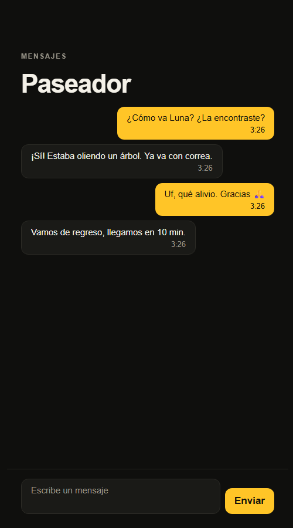
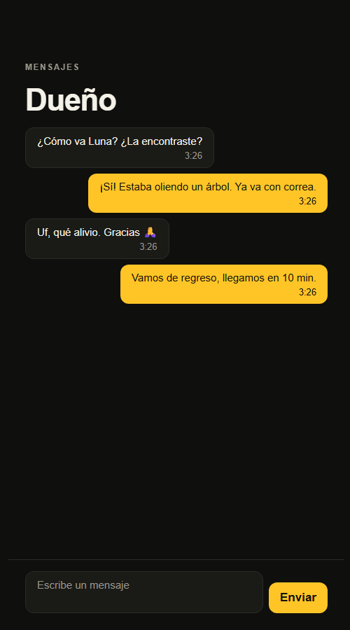

# RF-013 — Chat del paseo

> Vault: `01 Proyecto/Requerimientos funcionales.md` (RF-013) · Roadmap: sprint 8, adelantado · Depende de RF-007

Como el chat con el conductor en Uber: mientras el paseo está **aceptado o en curso**, el dueño y el paseador se escriben dentro de la app ("¿Ya llegaste?", "Luna tomó agua"). Al terminar o cancelar el paseo, la conversación queda **solo lectura**.

> [!note] Decisiones asumidas por el desarrollador
> - **Transporte**: la app consulta los mensajes nuevos cada 3 s (`?after=`). SignalR llega en el mismo slice que la ruta en vivo (RNF-007).
> - Solo texto (hasta 1.000 caracteres). Fotos y audios quedan para después.

## Historia de usuario
Como **dueño o paseador** quiero **escribirle a la otra persona del paseo sin salir de la app** para **coordinar la recogida y saber cómo va todo**.

## Criterios de aceptación
- [x] El dueño y el paseador asignado envían mensajes de texto mientras el paseo está `Accepted` o `InProgress`.
- [x] Ambos leen la conversación en orden; se pueden pedir solo los mensajes posteriores a uno dado.
- [x] Nadie más lee ni escribe en el chat del paseo.
- [x] Con el paseo `Requested`, `Completed` o `Cancelled` no se puede escribir, pero sí leer.

## Tabla de ejemplos
| # | Entrada | Resultado esperado | Tipo |
|---|---|---|---|
| 1 | El dueño `POST /walks/{id}/messages` `{ text: "¿Ya llegaste?" }` en un paseo `Accepted` | 200; mensaje con `sentBy: Owner` | Feliz |
| 2 | El paseador responde "Estoy en la portería" | 200; `sentBy: Walker` | Feliz |
| 3 | Cualquiera de los dos `GET /walks/{id}/messages` | Los dos mensajes en orden de envío | Feliz |
| 4 | `GET /walks/{id}/messages?after={id del primero}` | Solo el segundo | Feliz |
| 5 | Un tercero lee o escribe | 404 `Walks.NotFound` | Seguridad |
| 6 | Escribir en un paseo `Completed` | 422 `Messages.ChatClosed` | Regla |
| 7 | Texto vacío o de más de 1.000 caracteres | 400 `Messages.InvalidText` | Error |

## Contrato de API
- `POST /api/v1/walks/{id}/messages` `{ "text": "…" }` → `WalkMessageResponse`.
- `GET /api/v1/walks/{id}/messages?after={messageId}` → lista de `WalkMessageResponse` en orden de envío:
```json
{ "id": "…", "sentBy": "Owner", "text": "¿Ya llegaste?", "sentAt": "…" }
```
Ambos endpoints: usuario autenticado; el handler verifica que sea el dueño o el paseador asignado.

## Diseño
- **Domain**: `Entities/Messaging/WalkMessage` (`Send`), errores `Messages.*`. `Enums/Walks/WalkParty` reemplaza a `AlertParty` (mismos valores, sin cambio de esquema) y `Walk.PartyOf(userId)` dice si alguien es el dueño, el paseador o nadie; lo usan alertas y mensajes.
- **Application**: `Messaging/Commands/SendMessage`, `Messaging/Queries/ListMessages`, `IWalkMessageRepository`.
- **Infrastructure**: `messaging.walk_messages` (índice por paseo y fecha), migración `AddWalkMessages`.
- **Mobile**: `features/messaging` — `ChatScreen` (burbujas: las propias a la derecha en amarillo, las de la otra persona a la izquierda; se refresca cada 3 s; solo lectura al terminar), `MessageBubble`, `useChat`. Rutas `/paseos/[id]/chat` y `/paseador/[id]/chat` (el detalle pasa a `[id]/index.tsx`); botón "Mensajes" en las dos pantallas del paseo cuando ya hay paseador.

| Dueño | Paseador |
|---|---|
|  |  |

## Preguntas abiertas para el PO
- [ ] ¿Se guardan los chats después del paseo? ¿Por cuánto tiempo?
- [ ] ¿Moderación (palabras prohibidas, compartir teléfonos)?
- [ ] ¿Fotos del perro durante el paseo?

## Trazabilidad
| Repo | Archivos | Pruebas |
|---|---|---|
| waggo-api | `Entities/Messaging/WalkMessage`, `Errors/Messaging/MessageErrors`, `Enums/Walks/WalkParty`, `Walk.PartyOf`; `Messaging/Commands/SendMessage`, `Messaging/Queries/ListMessages`, `IWalkMessageRepository`; `WalkMessageConfiguration`, `WalkMessageRepository`, migración `AddWalkMessages`; `Endpoints/Messaging/*` | `MessageEndpointTests` (ejemplos 1–7), `WalkMessageTests`, `WalkTests.PartyOf`, `MessageHandlersTests` |
| waggo-mobile | `src/features/messaging/**`, `src/app/{paseos,paseador}/[id]/{index,chat}.tsx`, botón "Mensajes" en `WalkStatusScreen` y `AssignedWalkScreen` | `messagesApi.test.ts`, `ChatScreen.test.tsx`, `WalkStatusScreen.test.tsx`, `AssignedWalkScreen.test.tsx` |
