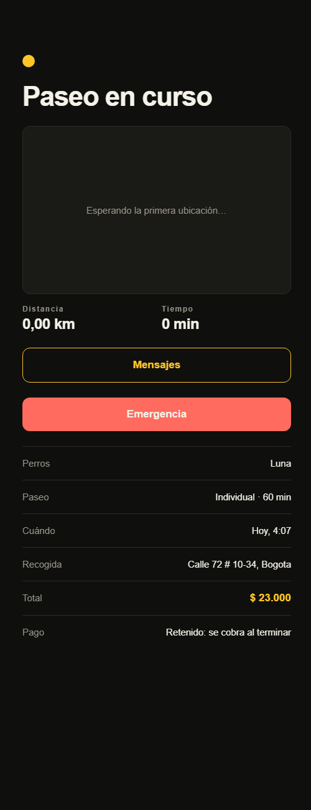
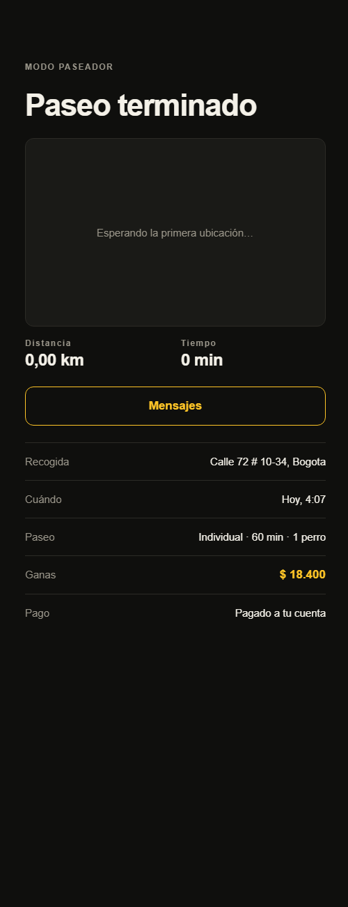
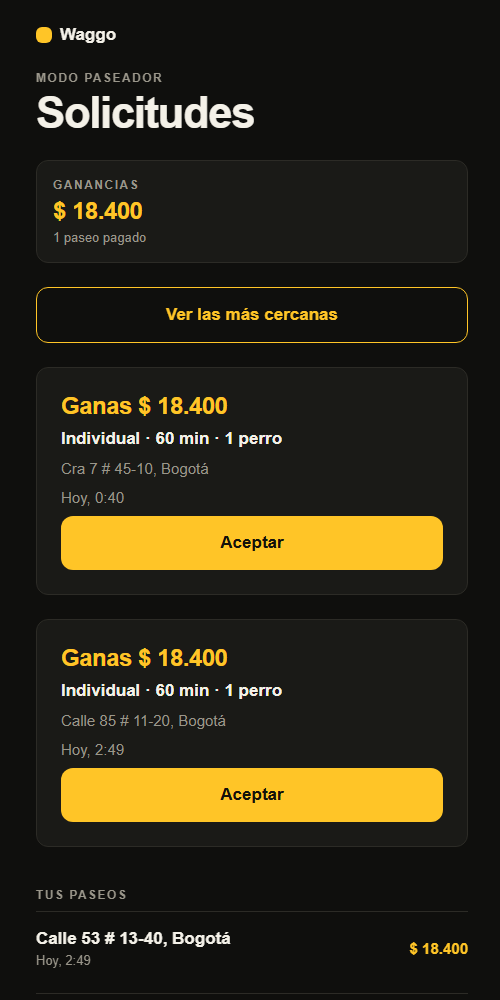

# RF-015 – RF-018 — Pagos con escrow

> Vault: `01 Proyecto/Requerimientos funcionales.md` (RF-015 – RF-018), RNF-004 · Roadmap: sprint 7 · Usa la tarifa congelada en el paseo (RF-019)

Como en Uber, no hay efectivo. Cuando el dueño **confirma** la solicitud, la plataforma **retiene** el total en su método de pago. Si el paseo se cancela antes de empezar, la retención se **libera**. Cuando el paseador termina, el pago se **cobra**: Waggo se queda con la **comisión** y el resto se **dispersa** al paseador. Nunca se guardan datos de tarjeta (RNF-004): solo la referencia que da la pasarela.

> [!note] Decisiones asumidas por el desarrollador
> - **Pasarela simulada** detrás de `IPaymentGateway` mientras el PO elige entre Stripe y MercadoPago (pregunta abierta del roadmap). Solo funciona en Development y Testing: en otro entorno la API no arranca con la pasarela simulada.
> - El dueño paga con su **método de pago por defecto** en la pasarela. El registro de tarjetas (formulario tokenizado del proveedor) llega con el proveedor real.
> - La simulación **rechaza** a los usuarios cuyo id contiene `card-declined`, como las tarjetas de prueba de Stripe, para probar el rechazo de punta a punta.
> - La retención se hace al **solicitar**: "confirmación" es el momento en que el dueño acepta el precio (RF-019). Si la pasarela rechaza, la solicitud no se crea.
> - Si la pasarela no responde al terminar o cancelar, la operación falla con 503 y se reintenta. No quedan paseos terminados sin cobrar.

## Historias de usuario
- Como **dueño** quiero **pagar dentro de la app al pedir el paseo** para **no manejar efectivo y saber que solo me cobran si el paseo ocurre**.
- Como **paseador** quiero **recibir mi parte automáticamente al terminar** para **no tener que cobrarle al dueño**.
- Como **plataforma** quiero **retener la comisión antes de dispersar** para **sostener el servicio**.

## Criterios de aceptación
- [x] Al solicitar un paseo se retiene el total en la pasarela y el pago queda `Held`. Si la pasarela rechaza, la solicitud falla con `Payments.Declined` y no se crea el paseo.
- [x] Al cancelar un paseo (solicitado o aceptado) la retención se libera: `Released`.
- [x] Al terminar el paseo el pago se cobra: `Captured`, con la comisión para Waggo y `walkerPayout` para el paseador.
- [x] El dueño y el paseador asignado ven el pago del paseo; nadie más.
- [x] El paseador ve lo que ha ganado: total y paseos cobrados, el más reciente primero.
- [x] No se guarda ningún dato de tarjeta, solo la referencia de la pasarela.

## Tabla de ejemplos
| # | Entrada | Resultado esperado | Tipo |
|---|---|---|---|
| 1 | Dueño solicita paseo individual de 60 min | 200; `GET /walks/{id}/payment` → `status: Held`, `total: 23000`, `commission: 4600`, `walkerPayout: 18400` | Feliz |
| 2 | Dueño `owner-card-declined-…` solicita | 422 `Payments.Declined`; no aparece en "Mis paseos" | Error |
| 3 | Dueño cancela el paseo solicitado | Pago `Released` | Feliz |
| 4 | Paseador termina el paseo | Pago `Captured` | Feliz |
| 5 | Paseador asignado consulta el pago | 200 | Feliz |
| 6 | Otro usuario consulta el pago | 404 `Walks.NotFound` | Autorización |
| 7 | Paseador `GET /payments/earnings` tras terminar un paseo | `total: 18400`, un paseo con `walkerPayout: 18400` | Feliz |
| 8 | Paseador sin paseos terminados | `total: 0`, lista vacía | Borde |

## Reglas de negocio
| Regla | Valor | Origen |
|---|---|---|
| Monto retenido | `Walk.Total` congelado al solicitar | RF-019 |
| Comisión | `Walk.Commission` (20 % hoy, configurable) | RF-018 |
| Dispersión | `Walk.WalkerPayout` al cobrar | RF-017 |
| Estados | `Held → Captured` o `Held → Released` | RF-016 |
| Moneda | La del paseo (`COP`) | — |

## Diseño
- **Domain**: `Entities/Payments/WalkPayment` (`Hold`, `Capture`, `Release`), `Enums/Payments/PaymentStatus`, `Errors/Payments/PaymentErrors`.
- **Application**: `IPaymentGateway` (`HoldAsync`, `CaptureAsync`, `ReleaseAsync`), `IWalkPaymentRepository`; `RequestWalk` retiene, `CancelWalk` libera, `FinishWalk` cobra; `Payments/Queries/{GetWalkPayment, GetMyEarnings}`.
- **Infrastructure**: `payments.walk_payments` (migración `AddWalkPayments`), `SimulatedPaymentGateway`, `PaymentOptions` (`Payments:Provider`).
- **Api**: `GET /api/v1/walks/{id}/payment`, `GET /api/v1/payments/earnings` (rol walker).
- **Mobile**: `features/payments`. `PaymentSummary` agrega la fila "Pago" en el detalle del paseo. El dueño ve "Retenido: se cobra al terminar", "Pagado" o "Liberado: no se cobró"; el paseador ve "Se paga al terminar", "Pagado a tu cuenta" o "Sin cobro: se canceló". `EarningsCard` muestra las ganancias en el inicio del paseador. Al pedir el paseo, la pantalla aclara: "Se retiene en tu método de pago y solo se cobra si el paseo ocurre."

| Dueño (en curso) | Paseador (terminado) | Ganancias |
|---|---|---|
|  |  |  |

## Preguntas abiertas para el PO
- [ ] Pasarela: Stripe o MercadoPago (Split payments y cuentas de paseadores).
- [ ] ¿Se cobra algo si el dueño cancela un paseo ya aceptado?
- [ ] ¿Cómo registra el paseador su cuenta para recibir dispersiones?

## Trazabilidad
| Repo | Archivos | Pruebas |
|---|---|---|
| waggo-api | `Entities/Payments/WalkPayment`, `Enums/Payments/PaymentStatus`, `Errors/Payments/PaymentErrors`; `IPaymentGateway`, `IWalkPaymentRepository`, `Models/Payments/{PaymentHold, PaymentCapture}`; `Payments/Queries/{GetWalkPayment, GetMyEarnings}`; `RequestWalk`, `CancelWalk` y `FinishWalk` retienen, liberan y cobran; `WalkPaymentConfiguration`, `WalkPaymentRepository`, `SimulatedPaymentGateway`, `PaymentOptions`, migración `AddWalkPayments`; `Endpoints/Payments` | `PaymentEndpointTests` (ejemplos 1–8), `WalkPaymentTests`, `RequestWalkHandlerTests`, `CancelWalkHandlerTests`, `StartAndFinishWalkHandlerTests` (con `PaymentMother`) |
| waggo-mobile | `src/features/payments/{api/paymentsApi, hooks/usePayments, model/{types, paymentText}, components/{PaymentSummary, EarningsCard}}`; `WalkStatusScreen`, `AssignedWalkScreen`, `WalkerHomeScreen`, `RequestWalkScreen` | `paymentsApi.test.ts`, `paymentText.test.ts`, `PaymentSummary.test.tsx`, `EarningsCard.test.tsx`, `RequestWalkScreen.test.tsx` |
