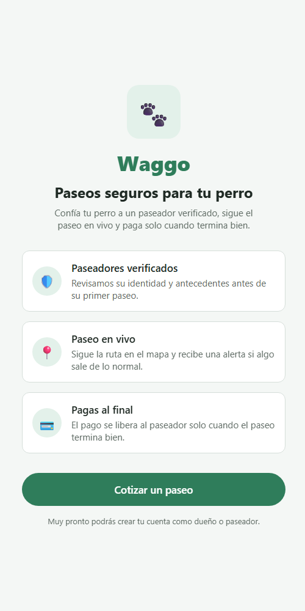
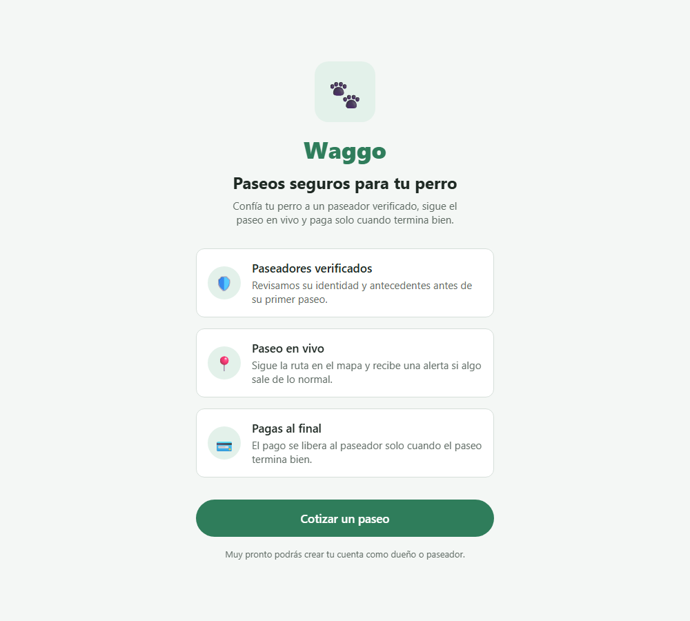

# UX-001 — Pantalla de bienvenida

> Vault: `01 Proyecto/Visión del proyecto.md` · `02 Arquitectura/Frontend - Expo feature-based.md` · Roadmap: sprint 1 (antes del registro RF-001)

Primera vista visual de la app. **No corresponde a un RF del SRS**: es la puerta de entrada que después llevará al registro (RF-001, RF-002) y al inicio de sesión (RF-005). Por eso usa el prefijo `UX-` en lugar de `RF-`. Solo afecta a `waggo-mobile` (no hay contrato de API).

> [!note] Decisiones asumidas por el desarrollador
> El PO no la ha validado todavía. Los textos y el orden de los pilares salen de la *Visión del proyecto*. Se revisan en la demo del sprint.

## Historia de usuario
Como **dueño que abre Waggo por primera vez** quiero **entender en segundos qué ofrece la app** para **decidir si le confío el paseo de mi perro**.

## Criterios de aceptación
- [x] Al abrir la app se ve la marca, un titular y los tres pilares de la propuesta de valor: confianza, paseo en vivo y pago al final.
- [x] Un botón principal lleva al cotizador de tarifa (RF-019), la única función disponible hoy.
- [x] Mientras no exista el registro, se informa que la creación de cuentas llega pronto. No se muestran botones que no hacen nada.
- [x] Es accesible: el titular tiene rol `header` y el botón tiene rol `button` con un nombre claro.

## Tabla de ejemplos
| # | Entrada | Resultado esperado | Tipo |
|---|---|---|---|
| 1 | Abrir la app | Se ven "Waggo", el titular (rol `header`) y los pilares numerados `01`–`03`: "Paseadores verificados", "Paseo en vivo" y "Pagas al final", cada uno con su descripción | Feliz |
| 2 | Tocar "Cotizar un paseo" | Se abre la ruta `/cotizar` con el cotizador de RF-019 | Feliz |
| 3 | El registro aún no existe | Se ve "Muy pronto podrás crear tu cuenta como dueño o paseador." y ningún botón de registro ni de inicio de sesión | Límite |
| 4 | `Button` compartido deshabilitado | Tocarlo no ejecuta la acción; expone `accessibilityState.disabled` | Error |
| 5 | `Button` compartido, variante `secondary` | Se renderiza con su texto y ejecuta la acción al tocarlo | Feliz |
| 6 | Tema de la app | La familia tipográfica es Helvetica (`Helvetica Neue` en iOS, `Helvetica` en web; sans del sistema en Android) | Feliz |

## Reglas de UI
| Regla | Valor | Origen |
|---|---|---|
| Titular | "Paseos seguros para tu perro" | Visión del proyecto |
| Pilares | Confianza (RF-002, RF-003) · Seguridad en vivo (RF-008 – RF-012) · Pagos (RF-015 – RF-017) | Visión del proyecto |
| Idioma | Español | ADR-008 |
| Colores y espaciados | Tokens de `src/shared/ui/theme.ts`, sin valores sueltos | Convenciones de código |
| Estilo visual | Mobile first, tema oscuro, amarillo `#FFC527` como único acento, Helvetica, estilo suizo sin emojis | ADR-013 |

## Contrato de API
No aplica: la pantalla es estática.

## Diseño
- `src/app/index.tsx` monta la `WelcomeScreen` sin encabezado y navega a `/cotizar` con `router.push`.
- `src/app/cotizar.tsx` monta el `FareQuoteScreen` existente, con el título "Cotizar paseo".
- `features/onboarding`: `WelcomeScreen` es presentacional y recibe `onQuotePress`. `ValueCard` pinta un pilar numerado (`01`) con un separador fino, y los pilares viven en `model/valuePillars.ts`.
- Composición: marca arriba a la izquierda (cuadro amarillo + "Waggo"), antetítulo, titular grande con "seguros" en amarillo, texto de apoyo, pilares y, fijo abajo, el botón amarillo y el aviso de registro.
- `shared/ui/Button` tiene variantes `primary` (amarillo) y `secondary` (borde amarillo) y soporta `disabled`. `theme.ts` define el tema oscuro, `fontFamily` (Helvetica), `typography`, `spacing` y `radius` (vault: `02 Arquitectura/ADR/ADR-013`).
- El tema oscuro se aplica a toda la app: encabezados del `Stack`, cotizador y chips.
- Mobile first: el contenido se limita a una columna de 480 px centrada en tablet y web.

> [!note] Cambio posterior (RF-007)
> Con el inicio del dueño (`/inicio`), la bienvenida tiene un solo botón, **"Empezar"**, que lleva al inicio. "Mis perros" y "Mis paseos" se abren desde ahí, y el precio se ve al pedir el paseo; el cotizador queda como ruta directa (`/cotizar`). El ejemplo 2 queda cubierto por "Empezar" (`WelcomeScreen.test.tsx`).

> [!note] Cambio posterior (RF-007, paseador)
> La bienvenida ofrece dos entradas, como una app de viajes: **"Quiero pasear a mi perro"** (inicio del dueño) y **"Soy paseador"** (`/paseador`).

> [!note] Cambio posterior (propuesta de diseño, 2026-10-26; rompe ejemplos 1 y 3)
> Implementado según `design/propuesta/07` · pantalla 1 y `08-marca.md`, por orden del PO:
> - **Cabecera**: el cuadro con la pata y el texto "Waggo" se reemplazan por el **logo completo** del corgi (150 px, centrado; en tema oscuro, la medalla crema). El logo es una sola imagen con etiqueta "Waggo" y es **provisional** (recoloreado del boceto, `assets/brand/`), hasta que exista el vector.
> - **Copy**: antetítulo "PASEADORES VERIFICADOS, EN VIVO", apoyo "Pide un paseo como pides un viaje: ves al paseador en el mapa y pagas al final." y frases nuevas de los pilares (`model/valuePillars.ts`); los pilares ya no van numerados sino con ícono en círculo.
> - **Entradas**: "Pedir un paseo" (dueño), "Quiero ser paseador" y el enlace "Ya tengo cuenta · Iniciar sesión" (`/login`). El ejemplo 3 (aviso "muy pronto" y sin botón de inicio de sesión) queda obsoleto: el registro y el login ya existen.
> - Pruebas: `WelcomeScreen.test.tsx` (logo con rol `image` y nombre "Waggo", tres entradas).

> [!note] Cambio posterior (barra de navegación, 2026-10-27)
> La barra global del `Stack` (`src/app/_layout.tsx`) ya no muestra "Waggo" ni el selector de tema: solo la flecha de volver (modo `minimal`), como en todas las pantallas de `design/propuesta/07`. En el flujo de entrada (login, registro, confirmar, olvidé y restablecer contraseña) la barra lleva además la cabeza del corgi a la derecha (`AuthBarLogo`); el título queda en el contenido (`AuthHeader`). El selector de tema (Claro/Oscuro, `radiogroup`) vive en **Configuración › Preferencias**, de ambos roles (pantalla 23). Consecuencia: sin sesión no hay selector de tema (la app arranca en claro, ADR-018); ver preguntas abiertas.

> [!note] Primera versión descartada
> La primera versión usaba fondo claro, verde, emojis y tarjetas centradas. En la revisión se vio genérica ("hecha con IA") y se cambió al diseño actual (ADR-013).

| Móvil (500 px) | Web (1000 px) |
|---|---|
|  |  |

## Plan TDD (mobile)
1. `Button.test.tsx`: ejemplos 4 y 5, más la variante `primary`.
2. `ValueCard.test.tsx`: pinta el número, el título y la descripción de un pilar.
3. `WelcomeScreen.test.tsx`: ejemplos 1, 2 (llama a `onQuotePress`) y 3.
4. `theme.test.ts`: ejemplo 6.

## Preguntas abiertas para el PO
- [ ] ¿Textos definitivos del titular y los pilares?
- [ ] ¿Logo oficial? Hoy la marca es un cuadro amarillo junto a la palabra "Waggo".
- [ ] ¿Debe poder cambiarse el tema antes de iniciar sesión (bienvenida o login)? El diseño solo lo pone en Configuración.

## Trazabilidad
| Repo | Archivos | Pruebas |
|---|---|---|
| waggo-mobile | `src/app/{_layout.tsx, index.tsx, cotizar.tsx}`, `app.json` (`userInterfaceStyle: dark`), `src/features/onboarding/{screens/WelcomeScreen.tsx, components/ValueCard.tsx, model/valuePillars.ts, index.ts}`, `src/shared/ui/{Button.tsx, ChipGroup.tsx, theme.ts}`, `src/features/pricing/{components/FareQuoteCard.tsx, screens/FareQuoteScreen.tsx}` (solo tema) | `WelcomeScreen.test.tsx` (ejemplos 1–3), `ValueCard.test.tsx`, `Button.test.tsx` (ejemplos 4–5), `theme.test.ts` (ejemplo 6) |
